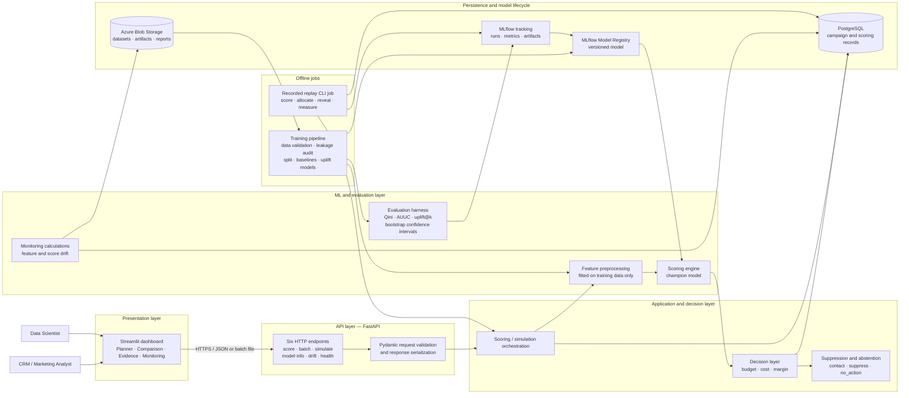
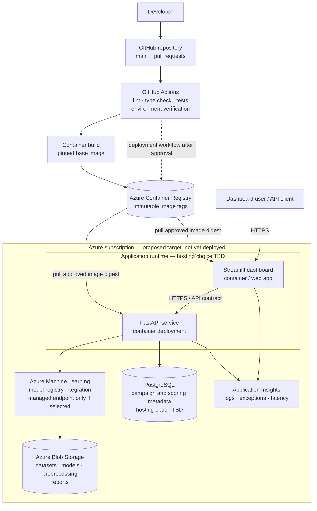

# NetLift Architecture

**Task:** T47 · **Issue:** [#59](https://github.com/mahmoud-nadeem/netlift/issues/59)  
**Owner:** Mazen Mahmoud · **Partner/reviewer:** Mahmoud Nadeem  
**Milestone:** M4 — System Analysis and Design  
**Document status:** Architecture design; Azure deployment topology is proposed, not deployed.

> **Status convention.** This document distinguishes (1) decisions and technologies stated in the project specification or revised project plan, (2) capabilities visible in the supplied repository snapshot, and (3) proposed deployment details that still require team approval. A proposed Azure topology must not be presented as an existing deployment.

## 1. Purpose and scope

NetLift is a causal decision system for incremental-profit optimization. It estimates conditional average treatment effects (CATE) from randomized-experiment data, converts uplift estimates into budget-aware targeting decisions, and evaluates candidate policies through simulated campaign replay.

The architecture is API-first. The FastAPI service exposes a stable contract independently of the Streamlit dashboard. The current semester uses historical randomized datasets and simulated replay; it does not operate a live campaign or observe new production outcomes.

This document covers the problem-to-architecture mapping, logical layers, technology stack, main components and data flows, proposed Azure deployment topology, and deployment/rollback practices.

### 1.1 Scope boundaries

**In the current semester scope**

- Validate and prepare Criteo-UPLIFT and Hillstrom randomized-experiment data.
- Train and evaluate uplift estimators against random, blanket and response-model baselines.
- Report Qini, AUUC and uplift@k with bootstrap confidence intervals and negative-control results.
- Serve scoring and policy-simulation contracts through the six API endpoints in Specification §35.
- Use an offline command-line job for recorded replay and log recorded experiments to MLflow.
- Provide a Streamlit dashboard as a client of the API.

**Production capabilities that remain deployment-only or future work**

- A permanent randomized holdout from live campaign traffic.
- A real-world conversion window and delayed outcome ingestion.
- Live treatment-assignment logging and continuous effect measurement.
- Scheduled retraining and drift-triggered model promotion.
- Live campaign delivery to an external campaign execution system.

A simulated replay over historical data is not a live campaign. In the replay, the original randomized control arm provides the comparison group; a new random holdout is not created.

### 1.2 Current implementation snapshot

The supplied repository snapshot shows the Python 3.12 package structure, pinned dependencies, GitHub Actions CI, data/evaluation contracts, MLflow tracking utility and the T45 API skeleton files. The T45 API implementation provides deterministic mocked responses; it does not yet load the registered champion model, execute the production replay implementation, persist scoring records or calculate real drift.

As checked on 15 November 2026, T45 PR [#112](https://github.com/mahmoud-nadeem/netlift/pull/112) is still open and awaiting Ali's review. Its API implementation should therefore be treated as work on a review branch, not as merged `main` functionality.

The supplied repository snapshot did not contain a `Dockerfile`, a Docker Compose file or Azure deployment manifests. Container packaging and cloud deployment are planned work, not capabilities claimed as already deployed.

## 2. Problem-to-architecture overview

The system must answer: *whose outcome changes because the campaign contacts them?* It must not substitute a response-probability ranking for an uplift estimate.

That product requirement drives the architecture:

| Problem or constraint | Architectural response |
|---|---|
| Individual treatment effects are not directly observed | Train and evaluate on randomized experiment data; report group-level uplift estimates with uncertainty. |
| Treatment and control groups can be unbalanced | Preserve the joint treatment/outcome split and validate randomization integrity before model training. |
| Post-treatment variables can leak the answer | Enforce feature contracts and forbidden-column checks before scoring or training. |
| A score is not yet a business action | Keep cost/margin policy, budget allocation, suppression and abstention in a distinct decision layer. |
| Model evidence must be reproducible | Track parameters, metrics, artifacts and model versions through MLflow. |
| The dashboard must not own ML logic | Make Streamlit an API client; keep scoring and policy behavior behind the FastAPI contract. |
| Historical data cannot demonstrate ongoing live lift | Use an offline simulated replay now; design a permanent randomized holdout and delayed outcome process only for a future live deployment. |
| Deployment must be repeatable and reversible | Package the service as a versioned container image, keep model versions identifiable, and retain a known-good deployment for rollback. |

## 3. Architecture principles

1. **Causal validity before model performance.** Randomization integrity, leakage checks and split integrity are gates, not optional monitoring.
2. **One contract across producers and consumers.** Feature/fold, metric and scoring interfaces are frozen in `docs/design/interfaces.md`; HTTP request/response behavior is documented in `docs/design/api-contract.md`.
3. **Separate scoring from decisions.** The scoring engine estimates uplift and uncertainty; the decision layer applies campaign economics and eligibility rules.
4. **Preserve abstention.** `insufficient_evidence` and `insufficient_control_data` are explicit outcomes, not silently converted into directional recommendations.
5. **Keep recorded replay offline.** Recorded replay and retraining are command-line/pipeline jobs. The API does not add scenario-creation, reveal or retraining endpoints.
6. **Make model and software versions traceable.** A scored response identifies its model version; deployment records should identify the code commit, image digest and configuration revision.
7. **Separate implemented behavior from target state.** The diagrams show both the project-semester path and production-only extensions without implying that Azure resources already exist.

## 4. Layered architecture

| Layer | Responsibility | Main technologies / modules |
|---|---|---|
| Presentation | Campaign planner, policy comparison, model evidence and monitoring views | Streamlit; charts using the project's visualization stack |
| API / transport | HTTP boundary, request validation, response serialization and OpenAPI | FastAPI, Pydantic, Uvicorn; `src/netlift/api/` |
| Application / decision | Score orchestration, cost/margin policy, budget allocation, abstention and suppression | `src/netlift/decision/`; policy/replay services |
| ML / evaluation | Data contracts, feature preparation, baselines, uplift estimators, metrics, bootstrap and explanations | `src/netlift/data/`, `features/`, `models/`, `evaluation/`; scikit-learn, LightGBM, XGBoost, scikit-uplift, causalml, SHAP |
| Experiment / model lifecycle | Reproducible runs, artifacts, evaluation metadata and model registry | MLflow; Optuna |
| Persistence | Campaign metadata, assignments, scoring records and outcomes; datasets and model artifacts | PostgreSQL; Azure Blob Storage (target) |
| Runtime / operations | CI, image build and distribution, cloud hosting, telemetry and rollback | GitHub Actions, Docker, Azure Container Registry, Azure services, Application Insights |

The API is a transport/application boundary, not a second implementation of the model or evaluation logic. It should call shared package services and preserve the T36 scoring response schema.

## 5. Technology stack

The table distinguishes the project specification's target stack from the packages and capabilities visible in the supplied repository snapshot.

| Area | Technology | Role and status |
|---|---|---|
| Language/runtime | Python 3.12 | Required project runtime; enforced by `pyproject.toml` and environment verification. |
| Tabular data | pandas, NumPy, PyArrow / Parquet | Data loading, transformations and storage for the large Criteo dataset; pinned in `requirements.txt`. |
| Classical ML | scikit-learn, LightGBM, XGBoost | Baselines and gradient-boosted outcome models; pinned in the environment. |
| Uplift modelling | scikit-uplift, causalml | Uplift estimators and the shared metric conventions; choices documented in ADR 0001. |
| Deep learning | PyTorch | Advanced shared-representation CATE challenger; deferred to the later implementation milestone. |
| Explainability | SHAP | Feature contribution analysis for model evidence. |
| Hyperparameter search | Optuna | Search against an uplift objective such as validation Qini. |
| Statistics | SciPy, statsmodels | Bootstrap intervals and statistical checks. |
| Experiment tracking | MLflow | Run parameters, metrics, artifacts and model registry. Local development uses the SQLite tracking backend `sqlite:///mlflow.db`. |
| API | FastAPI, Pydantic, Uvicorn | Typed HTTP service and generated OpenAPI contract; pinned as T45 API dependencies. |
| Dashboard | Streamlit | Four analytical dashboard tabs; planned for the implementation milestone. |
| Visualisation | Matplotlib, Plotly | Static analysis/report figures and interactive dashboard charts. The supplied requirements currently pin Matplotlib and Seaborn; Plotly remains a specification-level choice, not a pinned dependency in that snapshot. |
| Relational persistence | PostgreSQL | Campaign, treatment-assignment, holdout-membership, scoring-run, score and outcome records; target architecture, not present as a deployed database. |
| Object storage | Azure Blob Storage | Datasets, preprocessing/model artifacts and reports; target Azure service. |
| Container | Docker | Reproducible API runtime; planned. No Dockerfile was present in the supplied snapshot. |
| Container registry | Azure Container Registry (ACR) | Store immutable, versioned service images; target Azure service. |
| Model/cloud integration | Azure Machine Learning | Managed endpoint and registry integration identified in the specification. The revised project plan makes a managed endpoint conditional on M5 schedule; final compute choice remains open. |
| Observability | Azure Application Insights | Target location for request logs, service errors and latency telemetry. |
| CI/CD | GitHub Actions | Existing CI runs lint, format, mypy, pytest and environment verification on pull requests and pushes to `main`; image build/push/deploy stages are future work. |
| Documentation | Markdown and Mermaid | Architecture and engineering decisions live beside the code; diagrams for this task are embedded as Mermaid in this file. |

### 5.1 Runtime and environment conventions

- **Local development:** Python 3.12 in `.venv`; install the pinned dependencies from `requirements-dev.txt` and `requirements.txt`.
- **Local experiment tracking:** MLflow uses `sqlite:///mlflow.db`; the database and artifact directory are ignored by Git.
- **Continuous integration:** GitHub Actions uses `ubuntu-24.04` and Python 3.12, creates a clean virtual environment, installs the development dependencies, and runs Ruff, formatting checks, mypy, pytest and `scripts/verify_environment.py`.
- **Cloud target:** a containerized API and dashboard with environment-specific configuration and secrets. Exact Azure hosting resources and environment names have not yet been selected or provisioned.

## 6. Component architecture

The component view shows responsibilities and the principal dependencies. The offline training/replay paths are separate from request-time scoring. The data and model stores shown on the right are target persistence services; local development currently uses local files and a local MLflow SQLite backend.

### 6.1 Request-time responsibilities

1. The client sends a single-customer or batch request to FastAPI over HTTPS.
2. The API validates the request and rejects malformed input or forbidden treatment/outcome/exposure fields.
3. The application layer obtains the selected model version and its preprocessing artifacts.
4. The scoring engine returns uplift and a 95% confidence interval.
5. The decision layer combines the score with campaign cost and margin, then applies the policy, suppression and abstention rules.
6. The API serializes the frozen T36 scoring response. The service records operational and scoring metadata in the persistence layer when that integration is implemented.

### 6.2 Offline training and replay responsibilities

The training pipeline validates the source data, tests randomization integrity, audits leakage, creates the joint stratified split, fits preprocessing on training data, trains baselines before uplift estimators, evaluates candidates and registers the selected model.

A recorded replay is an offline command-line job logged to MLflow. It uses the same replay logic as `POST /policy/simulate`, but the interactive simulation endpoint does not create a recorded replay run. Until the locked-test procedure is authorized, replay is restricted to the validation split; access to the locked test split is governed by `LockedTestSplit.open(reason)` and the T70 procedure.

## 7. Deployment architecture

### 7.1 Deployment status

The Azure services below are named in the project specification, but the team has not yet selected or provisioned the Azure deployment. The revised project plan states container deployment to Azure as the baseline and makes an Azure ML managed endpoint conditional on M5 being ahead of schedule.

Accordingly, the diagram is a **proposed target topology**, not a record of deployed infrastructure. The exact Azure compute host for the API, dashboard hosting service, PostgreSQL hosting option, networking and secrets arrangement remain to be decided.

### 7.2 Proposed Azure topology

**Service mapping**

| Concern | Specification-aligned target | Selection/status |
|---|---|---|
| API runtime | Containerized FastAPI service | Container deployment is the plan; exact Azure compute host is TBD. Azure ML managed endpoint is conditional. |
| Dashboard runtime | Streamlit | Hosting service TBD. |
| Container images | Azure Container Registry | Named by the specification; not provisioned in the supplied snapshot. |
| Model registry / serving integration | MLflow Model Registry with Azure ML integration | Target design; cloud integration not implemented in the supplied snapshot. |
| Datasets and artifacts | Azure Blob Storage | Named by the specification; not provisioned. |
| Relational records | PostgreSQL | Named by the specification; managed hosting choice TBD. |
| Telemetry | Azure Application Insights | Named by the specification; not provisioned. |
| Build and release automation | GitHub Actions | CI exists; container publishing and Azure deployment stages remain future work. |

The architecture intentionally avoids naming Azure App Service, Container Apps, AKS or another compute host as a team decision. The project documents have not selected one.

## 8. Deployment strategy

The deployment process below is the proposed operating practice for the target container deployment. It does not claim that the cloud pipeline has already been implemented.

### 8.1 Environments

| Environment | Purpose | Configuration and data |
|---|---|---|
| Local development | Implement features, run tests and experiment locally | Python 3.12 `.venv`; pinned dependencies; local SQLite-backed MLflow; synthetic or approved development data. |
| CI | Reproduce checks on every pull request and on pushes to `main` | Clean Ubuntu 24.04 runner, Python 3.12, dependencies installed from the pinned requirements files, no production credentials. |
| Azure development / test (proposed) | Validate a built image and its configuration against non-production services | Isolated resources and non-production data; no access to the locked test split except through the approved procedure. |
| Azure production/demo (proposed) | Host the approved API and dashboard image for the demonstration or future users | Explicit model version, approved configuration and protected secrets; live campaign delivery and permanent holdout remain outside current-semester scope. |

Separate Azure development, staging and production environments are a recommendation. The team has not yet approved names, subscriptions, resource groups or promotion gates.

### 8.2 Container image versioning

1. Build the image only from a reviewed, tested commit.
2. Tag each build with an immutable Git commit identifier, for example `netlift-api:git-<short-sha>`. A human release tag may be added for a milestone, but it must point to the same image digest.
3. Do not use `latest` as the deployment identity. Record the immutable image digest used by each environment.
4. Promote the same image digest through environments; do not rebuild different images for test and production.
5. Record, alongside each deployment, the Git commit, image digest, model version, configuration revision and deployment timestamp.
6. Keep model versioning separate from application image versioning. An API image can remain unchanged while the loaded champion model version changes.

These tag and promotion conventions are proposed practices for T47; the repository snapshot does not yet contain a container build or release workflow.

### 8.3 Release sequence

1. A pull request runs the existing CI checks.
2. After review and merge to `main`, a release workflow builds the Docker image from the merged commit.
3. The workflow tags the image with the commit SHA and pushes it to ACR.
4. The image is deployed to the selected non-production Azure runtime.
5. Smoke tests check `/health`, OpenAPI availability and a mocked or approved scoring request.
6. A reviewer approves promotion to the demo/production environment.
7. The deployment record stores the image digest and model/configuration versions. Application Insights is used for request errors and latency once connected.

The image build, ACR push, deployment automation and cloud smoke tests are future CI/CD work; they are not part of the existing CI workflow in the supplied snapshot.

### 8.4 Rollback strategy

Rollback must restore a compatible **application image, model version and configuration**, not merely restart the newest container.

1. Retain the last known-good image digest and the model version used with it.
2. If a release fails health checks, produces API contract errors, or breaches operational thresholds, stop promotion.
3. Redeploy the previous known-good image digest.
4. Restore the previously approved model version and configuration revision.
5. Run health and scoring smoke tests before returning traffic.
6. Preserve logs and the failed deployment metadata for diagnosis; do not delete the failed image or model record during investigation.

Model candidates should be registered with their evaluation artifacts while the previous model version remains available. Model promotion must follow the team's evaluation and locked-test rules; it must not be inferred from a successful container deployment.

The exact traffic-switching method (for example, slot swap, blue/green or rolling replacement) depends on the Azure compute host and is intentionally left open until that service is selected.

## 9. Observability, reliability and security considerations

- **Service health:** `/health` exposes liveness/readiness. The production readiness signal must reflect whether the required model and dependencies are available; the T45 mock readiness response is not production readiness.
- **API contract:** `/openapi.json` and `/docs` expose the generated API contract. API changes remain subject to the T36 scoring schema and T45 contract tests.
- **Model traceability:** every scoring response carries `model_version`; deployment metadata should make the image digest and loaded model version jointly traceable.
- **Statistical monitoring:** feature drift and score drift can be computed from current inputs and scores. Effect drift needs outcome feedback and a valid control comparison; with historical data the project demonstrates it through replay rather than claiming live effect monitoring.
- **Logging:** application errors and request latency are intended for Application Insights. Scoring/campaign records belong in PostgreSQL; experiment runs and model artifacts belong in MLflow/Blob storage according to their respective lifecycles.
- **Secrets:** credentials and connection strings must be supplied through environment-specific secret configuration, not committed to Git. The precise Azure secret-management service and network boundaries remain to be selected.
- **Cost:** shut down idle compute, set an Azure budget alert below the available credit, and train locally where practical. The specification explicitly recommends using cloud credits for the managed endpoint, storage, monitoring and registry rather than unnecessary GPU training.

Authentication, authorization, network isolation, encryption/key management, retention periods and disaster-recovery objectives are not fully defined in the current project documents. They must be specified before any real customer or campaign data is served in production.

## 10. Open deployment decisions

The following are intentionally not represented as approved architecture decisions:

| Decision | Current position | Required next step |
|---|---|---|
| API compute host | Container deployment to Azure is the baseline plan; Azure ML managed endpoint is conditional | Select the Azure compute service with the team and confirm cost/operational fit. |
| Dashboard host | Streamlit is the specified frontend; hosting is undecided | Select whether it shares the API runtime boundary or has a separate web host. |
| PostgreSQL hosting | PostgreSQL is specified; cloud-managed service is not selected | Choose hosting, access boundary, backup and retention policy. |
| Model registry integration | MLflow Registry is the application contract; Azure ML integration is named in the specification | Confirm the concrete registry/serving integration and model-loading identity. |
| CI/CD promotion | GitHub Actions CI exists; image publishing/deployment do not appear in the supplied snapshot | Add build, scan, publish, deploy, smoke-test and approval stages in the implementation task. |
| Environment topology | Local and CI environments exist; Azure environments are proposed | Agree resource groups/subscriptions, configuration separation and secrets handling. |

Any decision that changes an interface, infrastructure dependency, deployment boundary or protected-data rule should be recorded in `docs/decisions/` through the team's pull-request process.

## 11. Source alignment

This design is based on the NetLift Project Specification, particularly:

- §4 — Complete System Workflow.
- §10–§15 — Decision policy, abstention, output schema, simulator, replay and production-only requirements.
- §18–§20 — Leakage, splitting and randomization integrity.
- §27–§34 — Evaluation, statistical significance, monitoring, experiment tracking and testing.
- §35 — Deployment Architecture and API endpoints.
- §36 — Technology Stack.
- §37 — Repository Structure.
- §57 — Final Architecture Diagram.

It also follows the repository's working agreement, the revised project plan, ADR 0001 (uplift-library selection), ADR 0002 (recorded replay and retraining as offline jobs), ADR 0003 (split design), `docs/design/interfaces.md` and the T45 API contract.

The Azure topology, environment separation, immutable image tags, promotion sequence and rollback procedure in Sections 7–9 are proposed engineering practices where the project documents do not yet specify a final service-level choice. They require review by the task partner before being treated as team decisions.
