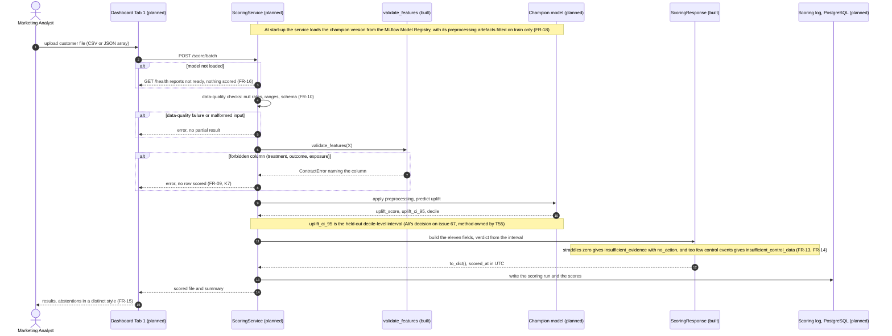
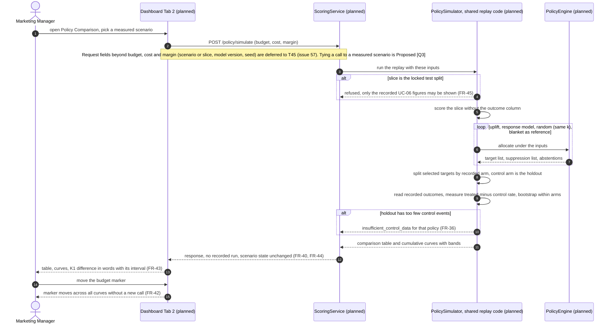
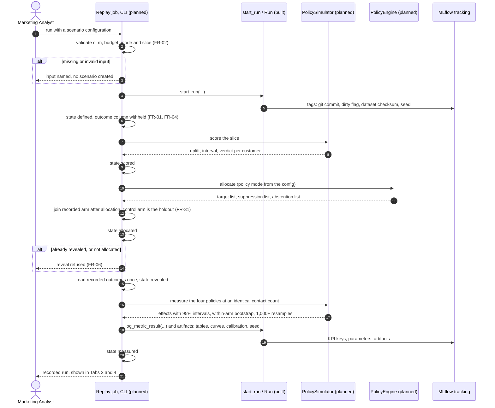
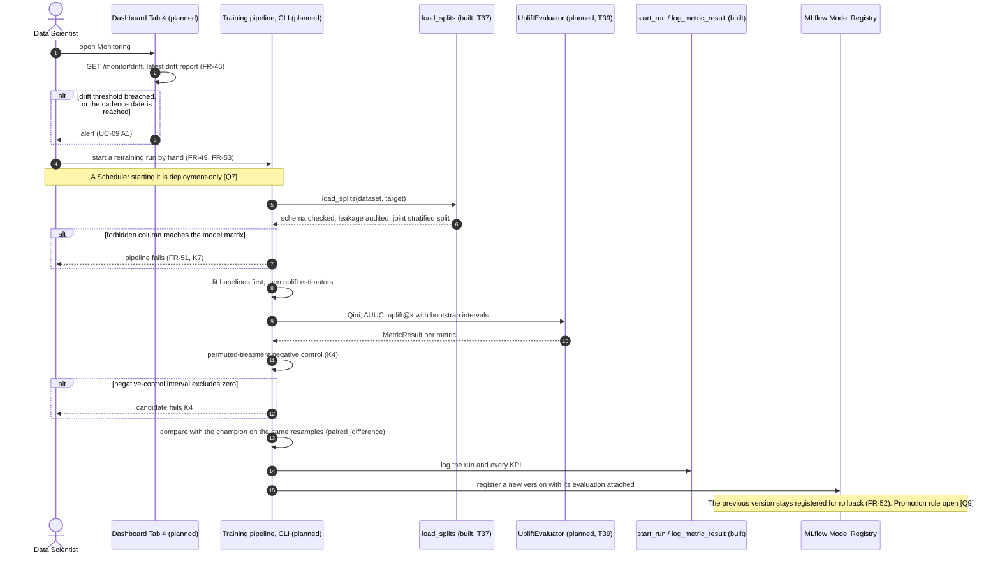
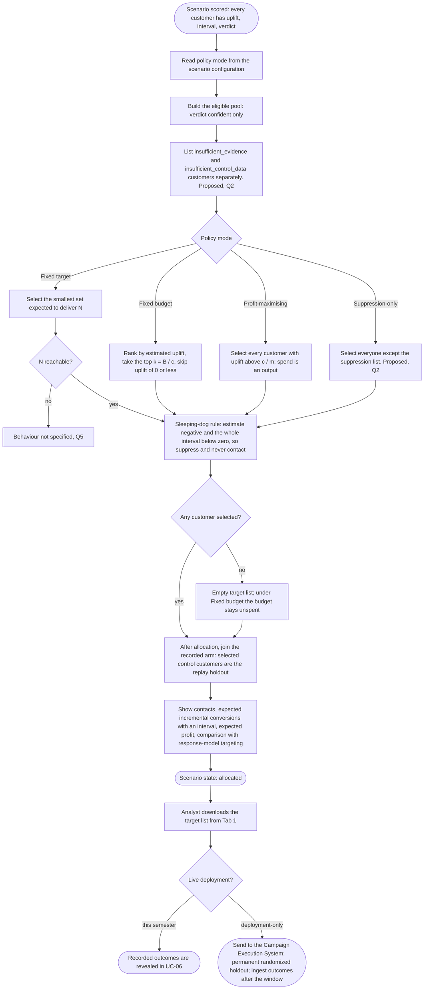
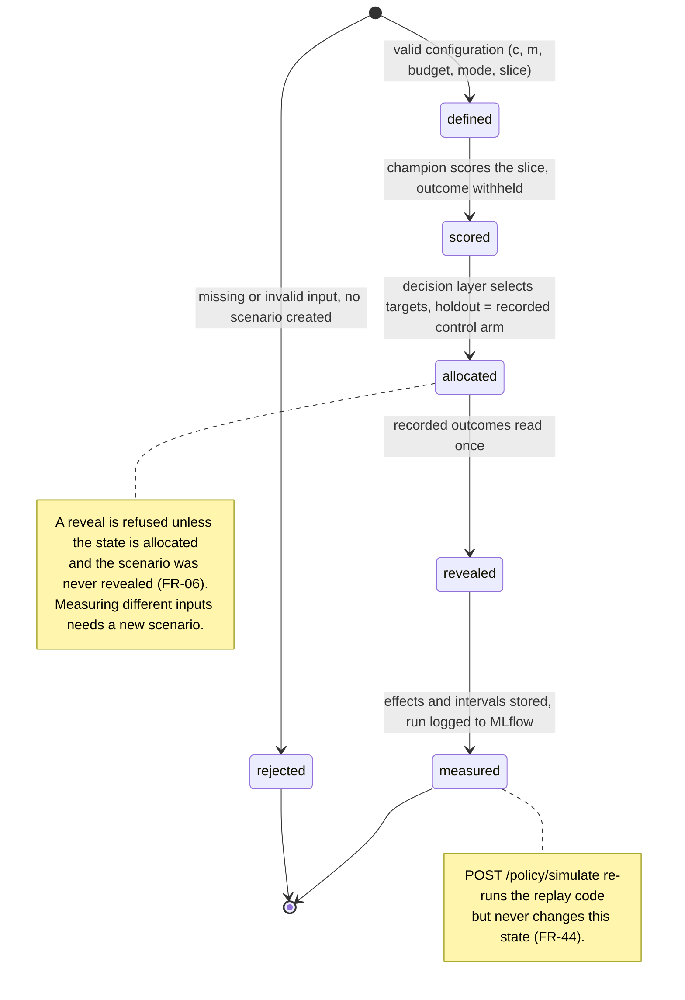

# Behaviour: problem, objectives and diagrams

**Task:** T50 (#62) · **Owner:** Mahmoud · **Reviewer:** Aliaa · **Status:** first draft (1 Nov 2026)

This document gives the problem statement and the objectives, then the class, sequence, activity
and state diagrams of NetLift. It draws only on the specification, the user stories and use cases
(`docs/requirements/02-user-stories-and-use-cases.md`, UC-01 to UC-10), the functional
requirements (`docs/requirements/03-functional-requirements.md`, FR-01 to FR-53), ADR 0002
(`docs/decisions/0002-replay-runs-as-offline-jobs.md`) and the interfaces
(`docs/design/interfaces.md`). It adds no component of its own.

**Built or planned.** Every element is marked:

- **built** means the code is on `main` today;
- **planned** means it is specified but not written yet, with the task that builds it;
- **deployment-only** means it would be needed for a live deployment and is not built this
  semester.

The diagrams are Mermaid, so GitHub renders them.

---

## 1. Problem statement

Retention and promotion budgets are usually spent by ranking customers on a model that predicts
*who will convert*. That model cannot tell a customer who converts *because* of the contact
(a persuadable) from one who would have converted anyway (a sure thing). It also cannot see the
customers who convert *less* because they were contacted (sleeping dogs). Budget is spent on
discounts nobody needed, and some contacts destroy value (specification, Problem Statement).

The quantity that matters is the effect of the contact on each customer: the conditional average
treatment effect τ(x) = E[Y(1) − Y(0) | X = x]. It is never observed for any single customer,
because each customer is either contacted or not. It can only be estimated for groups, from
randomized experiment data, and it has to be reported with an interval, because the signal is
small and the control group is thin.

NetLift estimates that effect on two randomized datasets (Criteo-UPLIFT and Hillstrom). It turns
the estimate into a contact decision under a budget, cost and margin, and measures what that
decision would have produced in a simulated replay over held-out experimental data. It is not a
live campaign; what a live deployment would add is stated separately (specification §15).

## 2. Objectives

Each objective maps to a KPI in `config/kpis.yaml` (specification §46).

| # | Objective | KPI |
|---|---|---|
| 1 | At the same contact count, produce more incremental conversions than targeting by a response model. The 95% interval of the difference is reported either way. | K1 (primary) |
| 2 | Rank customers better than random targeting: Qini coefficient and AUUC with bootstrap intervals resampled within treatment arms. | K2 |
| 3 | State incremental profit per unit of spend, with the cost and margin named on the same line. | K3 |
| 4 | Show that the pipeline finds no effect when there is none: a permuted-treatment negative control. | K4 |
| 5 | Check that predicted effects match measured effects per decile. | K5 |
| 6 | Confirm that each dataset behaves as a randomized experiment before any model is trained. | K6 |
| 7 | Keep post-treatment columns out of every model matrix, enforced in CI. | K7 |
| 8 | Reproduce every headline number from configuration plus a git commit. | K8 |
| 9 | Serve single and batch scoring within the team-set latency targets. | K9 |
| 10 | Keep CI green on every merge, and every DEPI artefact current. | K10, K11 |

---

## 3. Class diagram: the pipeline object model

The three frozen interfaces are the built core. Interface 1 is the data contract, interface 2 the
metric result, and interface 3 the scoring response. The tracking wrapper sits beside them. The
planned classes use the names in the specification's DEPI documentation table (§45). Module-level

```mermaid
classDiagram
    direction LR

    class TreatmentDefinition {
        <<built: interface 1>>
        +source_column: str
        +treatment_values
        +control_values
        +excluded_values
    }
    class FeatureMatrixMeta {
        <<built: interface 1>>
        +dataset: DatasetName
        +target_outcome: TargetOutcome
        +treatment: TreatmentDefinition
        +seed: int
        +split_name: SplitName
    }
    class FeatureMatrix {
        <<built: interface 1>>
        +X: DataFrame
        +t: int8 array
        +y: int8 array
        +fold: int64 array
        +row_id: int64 array
        +meta: FeatureMatrixMeta
        +cell_counts() DataFrame
    }
    class LockedTestSplit {
        <<built: interface 1>>
        +meta: FeatureMatrixMeta
        +row_ids: int64 array
        +is_open: bool
        +open(reason) FeatureMatrix
    }
    class DatasetSplits {
        <<built: interface 1>>
        +train: FeatureMatrix
        +validation: FeatureMatrix
        +test: LockedTestSplit
    }
    class DataContracts {
        <<module: data.contracts, built>>
        +validate_features(X)
        +check_control_events(matrix, min_control_events)
    }
    class DataPipeline {
        <<module: data.pipeline, built in T37>>
        +load_splits(dataset, target) DatasetSplits
        +build_splits(prepared, cfg) DatasetSplits
        +plan_split(prepared, cfg)
    }
    class Prepared {
        <<built in T37>>
        +X: DataFrame
        +arm
        +t
        +in_scope
        +y_visit
        +y_conversion
        +row_id
    }

    class MetricResult {
        <<built: interface 2>>
        +name: str
        +value: float
        +ci_low: float
        +ci_high: float
        +confidence_level: float
        +n_resamples: int
        +seed: int
        +library: str
        +resamples
        +resample_fingerprint: str
        +evaluation_fingerprint: str
        +split_name: SplitName
        +settings: dict
        +metric_key: str
    }
    class UpliftMetric {
        <<protocol: interface 2, built>>
        +__call__(y, uplift, t, n_resamples, confidence_level, seed) MetricResult
    }
    class EvaluationContracts {
        <<module: evaluation.contracts, built>>
        +within_arm_bootstrap_indices(t, n_resamples, seed)
        +fingerprint_indices(indices) str
        +fingerprint_evaluation_set(y, t) str
        +paired_difference(a, b) MetricResult
        +log_metric_result(run, kpi_id, result) str
    }

    class ScoringResponse {
        <<built: interface 3>>
        +customer_id: str
        +model_version: str
        +uplift_score: float
        +uplift_ci_95
        +decile: int
        +segment_label: SegmentLabel
        +expected_incremental_profit: float
        +recommendation: Recommendation
        +verdict: Verdict
        +top_drivers
        +scored_at: datetime
        +to_dict() dict
        +from_dict(data) ScoringResponse
    }
    class Driver {
        <<built: interface 3>>
        +feature: str
        +contribution: float
    }

    class Run {
        <<built: utils.tracking>>
        +log_params(params)
        +log_metrics(metrics)
        +log_kpi(kpi_id, value, ci_low, ci_high) str
        +log_artifact(path)
        +set_tags(tags)
    }
    class Tracking {
        <<module: utils.tracking, built>>
        +start_run(run_name, dataset, seed, experiment, tags) Run
    }

    class Baselines {
        <<planned: T38>>
        random, blanket, response model
    }
    class BaseLearner {
        <<planned>>
        LightGBM or XGBoost base model
    }
    class UpliftEstimator {
        <<planned, abstract>>
        +fit(matrix)
        +predict(X) uplift
    }
    class TLearner {
        <<planned: meta-learner>>
    }
    class XLearner {
        <<planned: meta-learner>>
    }
    class UpliftForest {
        <<planned: Advanced tier>>
    }
    class UpliftEvaluator {
        <<planned: T39>>
        Qini, AUUC, uplift@k
    }
    class PolicyEngine {
        <<planned: decision layer>>
        Fixed budget, Profit-maximising,
        Fixed target, Suppression-only
    }
    class PolicySimulator {
        <<planned: shared replay code>>
        replay job and POST /policy/simulate
    }
    class ScoringService {
        <<planned: FastAPI, six endpoints>>
    }
    class Dashboard {
        <<planned: Streamlit, four tabs>>
    }

    DatasetSplits *-- FeatureMatrix : train, validation
    DatasetSplits *-- LockedTestSplit : test
    LockedTestSplit o-- FeatureMatrix : wraps
    FeatureMatrix *-- FeatureMatrixMeta
    FeatureMatrixMeta --> TreatmentDefinition
    DataPipeline ..> Prepared : splits
    DataPipeline ..> DatasetSplits : returns
    DataPipeline ..> DataContracts : validates with
    ScoringResponse *-- Driver : top_drivers
    UpliftMetric ..> MetricResult : returns
    EvaluationContracts ..> MetricResult
    EvaluationContracts ..> Run : logs through
    Tracking ..> Run : yields

    UpliftEstimator <|-- TLearner
    UpliftEstimator <|-- XLearner
    UpliftEstimator <|-- UpliftForest
    UpliftEstimator o-- BaseLearner : base models
    Baselines ..> DatasetSplits : trained on
    UpliftEstimator ..> DatasetSplits : trained on
    UpliftEvaluator ..|> UpliftMetric : implements
    UpliftEvaluator ..> EvaluationContracts : resamples with
    PolicySimulator ..> PolicyEngine : allocates with
    PolicySimulator ..> UpliftEstimator : scores with
    PolicySimulator ..> Baselines : compares with
    ScoringService ..> ScoringResponse : returns
    ScoringService ..> UpliftEstimator : loads champion
    ScoringService ..> PolicySimulator : POST /policy/simulate
    Dashboard ..> ScoringService : calls the API
```

functions are shown as `<<module>>` boxes.

Notes:

- The spec's class table also names `DatasetLoader`, `SchemaValidator`, `LeakageAuditor` and
  `StratifiedSplitter`. In the built code those roles are functions, not classes:
  - loaders: `load_hillstrom` and `load_criteo` in `data/loaders.py`;
  - schema: `check_hillstrom` and `check_criteo` in `data/schema.py`;
  - leakage: `validate_features` in `data/contracts.py`;
  - split: `assign_splits` in `data/split.py`, called by `plan_split`.

  The class diagram shows the module that holds each group.
- `NeuralCATE`, the shared-representation neural estimator, is NICE TO HAVE in the spec's scope
  and is left out. If it is built, it is one more subclass of `UpliftEstimator`.
- Pending in T41 (#104), and not drawn yet:
  - a required `task` on `start_run`, with `experiment_name` and `run_name` helpers;
  - `fingerprint_evaluation_set` gaining required `row_ids` and `dataset`, and the `UpliftMetric`
    protocol gaining `split_name`, `row_ids` and `dataset` (ADR 0004).
- Training and promotion lead to the MLflow Model Registry. The registry is a component, not a
  class of ours. It appears in the sequence and state diagrams.

---

## 4. Sequence diagrams

### 4.1 Batch scoring: `POST /score/batch` (UC-02)

Every step behind the API is **planned** (T45 skeleton, T59 service), except the three built
contracts it calls: `validate_features`, `ScoringResponse` and the verdict rules inside it.

`POST /score` follows the same path for one customer and returns one response object (FR-08).

### 4.2 Policy simulation: `POST /policy/simulate` (UC-07)

The simulate call re-runs the same replay code as the recorded job. It does not read the stored
result, and it creates no recorded MLflow run (ADR 0002, decision 2). All of it is **planned**.

### 4.3 Recorded replay as an offline job (UC-01, UC-02, UC-05, UC-06)

One command-line run covers the replay's steps [1] to [8] and is the only way a replay result
becomes a recorded result (ADR 0002, decision 1). Until Q1 is decided, replays use the validation
split only, and the locked test split opens only through `LockedTestSplit.open(reason)` under
T70. The job is **planned**. `start_run` and `log_metric_result` are **built**.

### 4.4 Retraining as an offline job (UC-09, UC-10)

Retraining is the same reproducible pipeline run again, started by hand this semester. A
scheduled trigger is **deployment-only** (ADR 0002, decision 3). What makes a retrained candidate
replace the champion is open (Q9), so the diagram stops at registration. The training stages
are **planned**, except the data pipeline (built in T37) and the tracking and metric contracts
(built).

---

## 5. Activity diagram: campaign planning (UC-05, UC-04)

From a scored scenario to a downloadable target list. In a recorded run the replay job calls the
decision layer (**planned**). Whether Tab 1 also calls it interactively is open (Q3). Delivery to a
campaign system is **deployment-only**.

Nothing in this flow reads the outcome column, and a test asserts it (FR-04).

---

## 6. State diagrams

### 6.1 Campaign lifecycle (replay scenario)

These are the states named in the specification (§14, §45), with the guards from UC-01, UC-06 and
UC-07. **Planned**, in the replay job.

### 6.2 Model lifecycle

The specification's registry stages are `registered` → `staging` → `production` → `archived`
(§45). The states below follow one model version from training to serving and back through
retraining. Training and evaluation are **planned** (T38 to T44). Registration and serving are
**planned** (M5).

```mermaid
stateDiagram-v2
    [*] --> trained : offline pipeline run, from config and a git commit
    trained --> evaluated : Qini, AUUC, uplift@k with bootstrap intervals; K4 negative control
    evaluated --> discarded : fails K4 or the leakage gate
    evaluated --> champion : registered as champion
    champion --> served : API loads this version at start-up
    served --> drift_flagged : drift threshold breached (feature or score drift)
    drift_flagged --> retrained : Data Scientist starts the pipeline by hand
    served --> retrained : cadence date reached
    retrained --> evaluated : new version, compared on the same resamples
    served --> archived : replaced by a newer champion
    archived --> served : rollback by version pin
    discarded --> [*]
    archived --> [*]

    note right of champion
        Registered in the MLflow Model Registry with its
        evaluation attached. The rule that promotes a retrained
        candidate over the current champion is open (Q9).
    end note
```

`registered as champion` and `served` correspond to the registry's `staging` and `production`.
`archived` is the registry stage of the same name.

---

## 7. Open points this document depends on

| Question | Where it shows |
|---|---|
| Q1: which split each replay uses; interim rule: validation only | 4.2, 4.3 |
| Q2: abstention and the eligible pool, Suppression-only | 4.1, 5 |
| Q3: whether Tab 1 allocates interactively; simulate request fields (T45, #57) | 4.2, 5 |
| Q5: unreachable Fixed target | 5 |
| Q7: the Scheduler is deployment-only | 4.4 |
| Q9: promotion of a retrained candidate | 4.4, 6.2 |
