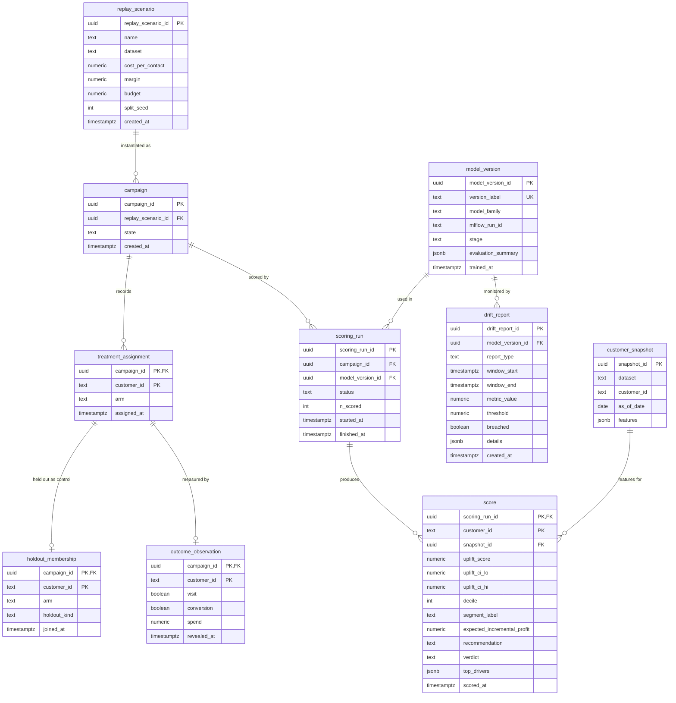

# NetLift Data Model

**Task:** T48, ERD, logical and physical schema ([#60](https://github.com/mahmoud-nadeem/netlift/issues/60)) · **Milestone:** M4 · **Owner:** @aliaaelrefaey · **Reviewer:** @MazenSr
**Status:** Draft · **Implemented by:** T60 (M5)
**Source:** `docs/NetLift_Project_Specification.tex` (ER diagram and logical/physical schema rows of the design-artefact table; persistence layer of the final architecture; Model Output Schema section)

This document defines the relational schema that records a replay, scoring and measurement cycle. The purpose of the database is to make the causal claim auditable: `treatment_assignment` and `holdout_membership` are the database's record of the experiment, and every `score` can be traced to the model version, scoring run and customer snapshot that produced it.

## 1. Conventions

| Topic | Decision |
|---|---|
| Engine | PostgreSQL (as in the deployment diagram) |
| Naming | `snake_case`, singular table names, `<table>_id` for surrogate keys |
| Surrogate keys | `uuid` (generated by the application) for entity tables; composite natural keys where the spec says "one row per customer per run" |
| Business keys | `customer_id` is a text key such as `c_00193472`; `model_version` is a label such as `netlift-xlearner-2026.11.03`. Both appear in the API contract and are kept verbatim |
| Time | `timestamptz`, stored in UTC |
| Enumerations | Implemented as `text` with `CHECK` constraints (cheaper to evolve than native enum types) |
| Scope of `customer_id` | Unique within a dataset, not across datasets. Every table that carries `customer_id` is scoped by `campaign_id` (and therefore by dataset) |
| Bulk data | Raw datasets, preprocessing artefacts and reports stay in Azure Blob (Parquet). PostgreSQL holds only what is needed for audit, serving and measurement |

## 2. Entities

The ER-diagram row of the specification lists nine entities: `customer_snapshot`, `replay_scenario`, `treatment_assignment`, `holdout_membership`, `scoring_run`, `score`, `model_version`, `outcome_observation`, `drift_report`. The persistence layer of the final architecture also lists `campaign`. This document includes `campaign` as a tenth table (see open question Q1).

## 3. Tables

Legend: **PK** primary key, **FK** foreign key, **UK** unique, **NN** not null.

### 3.1 `replay_scenario`

The definition of a replay: which dataset, and the economic parameters used by the policy simulator (per-contact cost, margin, budget).

| Column | Type | Constraints | Notes |
|---|---|---|---|
| `replay_scenario_id` | uuid | PK | |
| `name` | text | NN, UK | Human-readable scenario name |
| `dataset` | text | NN, CHECK in (`criteo`, `hillstrom`) | |
| `cost_per_contact` | numeric(12,4) | NN, CHECK >= 0 | |
| `margin` | numeric(12,4) | NN, CHECK >= 0 | |
| `budget` | numeric(14,2) | NN, CHECK >= 0 | |
| `split_seed` | integer | NN | Seed of the stratified split, for reproducibility |
| `created_at` | timestamptz | NN, default `now()` | |

### 3.2 `campaign`

One execution of a scenario. Carries the campaign lifecycle state.

| Column | Type | Constraints | Notes |
|---|---|---|---|
| `campaign_id` | uuid | PK | |
| `replay_scenario_id` | uuid | NN, FK to `replay_scenario` | |
| `state` | text | NN, CHECK in (`defined`, `scored`, `allocated`, `revealed`, `measured`) | State machine from the spec |
| `created_at` | timestamptz | NN, default `now()` | |

### 3.3 `customer_snapshot`

Customer features as of a date. Features differ per dataset (Criteo has anonymised numeric features, Hillstrom has named ones), so they are stored as `jsonb` (see section 6).

| Column | Type | Constraints | Notes |
|---|---|---|---|
| `snapshot_id` | uuid | PK | |
| `dataset` | text | NN, CHECK in (`criteo`, `hillstrom`) | |
| `customer_id` | text | NN | |
| `as_of_date` | date | NN | |
| `features` | jsonb | NN | Feature name to value |
| | | UK (`dataset`, `customer_id`, `as_of_date`) | Natural key |
| | | UK (`snapshot_id`, `customer_id`) | Target of the composite foreign key from `score`: a score can only point to a snapshot of its own customer |

### 3.4 `treatment_assignment`

Which arm each customer was in. Together with `holdout_membership`, this is the experiment's record.

| Column | Type | Constraints | Notes |
|---|---|---|---|
| `campaign_id` | uuid | PK part 1, FK to `campaign` | |
| `customer_id` | text | PK part 2 | |
| `arm` | text | NN, CHECK in (`treatment`, `control`) | |
| `assigned_at` | timestamptz | NN, default `now()` | |
| | | UK (`campaign_id`, `customer_id`, `arm`) | Target of the composite foreign key from `holdout_membership`, so a held-out customer must be assigned to `control` |

### 3.5 `holdout_membership`

Customers held out of policy contact so that the causal effect can be measured. In this project the counterfactual comes from the dataset's randomized control arm (simulated replay); a permanent randomized holdout is deployment-only, and this table is shaped to hold it.

| Column | Type | Constraints | Notes |
|---|---|---|---|
| `campaign_id` | uuid | PK part 1 | |
| `customer_id` | text | PK part 2 | |
| `arm` | text | NN, default `control`, CHECK = `control` | Always `control`; exists so the foreign key below can enforce it |
| `holdout_kind` | text | NN, CHECK in (`replay_control`, `permanent_holdout`) | |
| `joined_at` | timestamptz | NN, default `now()` | |
| | | FK (`campaign_id`, `customer_id`, `arm`) to `treatment_assignment` (`campaign_id`, `customer_id`, `arm`) | A customer can be held out only if the same campaign assigned them to `control` |

### 3.6 `model_version`

A registered model. Carries the model lifecycle stage and the evaluation attached at registration.

| Column | Type | Constraints | Notes |
|---|---|---|---|
| `model_version_id` | uuid | PK | |
| `version_label` | text | NN, UK | E.g. `netlift-xlearner-2026.11.03`; the value exposed as `model_version` in the API |
| `model_family` | text | NN | E.g. `xlearner`, `tlearner`, `uplift_forest` |
| `mlflow_run_id` | text | NN | Link to the MLflow run and registry entry |
| `stage` | text | NN, CHECK in (`registered`, `staging`, `production`, `archived`) | Model lifecycle from the spec |
| `evaluation_summary` | jsonb | NN | AUUC, Qini and uplift@k with intervals at registration |
| `trained_at` | timestamptz | NN | |

### 3.7 `scoring_run`

One batch scoring of a campaign with one model version.

| Column | Type | Constraints | Notes |
|---|---|---|---|
| `scoring_run_id` | uuid | PK | |
| `campaign_id` | uuid | NN, FK to `campaign` | |
| `model_version_id` | uuid | NN, FK to `model_version` | |
| `status` | text | NN, CHECK in (`running`, `succeeded`, `failed`, `blocked_data_quality`) | The spec blocks a scoring run on data-quality failure |
| `n_scored` | integer | CHECK >= 0 | |
| `started_at` | timestamptz | NN | |
| `finished_at` | timestamptz | CHECK >= `started_at` | Null while running |

### 3.8 `score`

One row per customer per run. Columns mirror the Model Output Schema contract.

| Column | Type | Constraints | Notes |
|---|---|---|---|
| `scoring_run_id` | uuid | PK part 1, FK to `scoring_run` | |
| `customer_id` | text | PK part 2 | |
| `snapshot_id` | uuid | NN | Exact features that were scored; see the composite foreign key below |
| `uplift_score` | double precision | NN | |
| `uplift_ci_lo` | double precision | NN | `uplift_ci_95[0]` |
| `uplift_ci_hi` | double precision | NN, CHECK >= `uplift_ci_lo` | `uplift_ci_95[1]` |
| `decile` | smallint | CHECK between 1 and 10 | |
| `segment_label` | text | NN, CHECK in (`persuadable`, `sure_thing`, `lost_cause`, `sleeping_dog`, `unknown`) | Derived, presentational; never ground truth |
| `expected_incremental_profit` | numeric(14,4) | | `margin * uplift - cost` |
| `recommendation` | text | NN, CHECK in (`contact`, `suppress`, `no_action`) | |
| `verdict` | text | NN, CHECK in (`confident`, `insufficient_evidence`, `insufficient_control_data`) | Separate field from `recommendation`; NOT NULL enforces "no recommendation without a verdict" |
| `top_drivers` | jsonb | | Array of `{feature, contribution}` |
| `scored_at` | timestamptz | NN | |

Table-level constraints:

| Constraint | Rule | Purpose |
|---|---|---|
| `fk_score_snapshot_customer` | FK (`snapshot_id`, `customer_id`) to `customer_snapshot` (`snapshot_id`, `customer_id`) | The snapshot must belong to the same customer as the score |
| `ck_score_verdict_recommendation` | `CHECK (verdict = 'confident' OR recommendation = 'no_action')` | A non-confident verdict (`insufficient_evidence`, `insufficient_control_data`) can never produce `contact` or `suppress` |

### 3.9 `outcome_observation`

The revealed outcome per customer per campaign, used by the measurement job.

| Column | Type | Constraints | Notes |
|---|---|---|---|
| `campaign_id` | uuid | PK part 1 | |
| `customer_id` | text | PK part 2 | |
| `visit` | boolean | | Present in both datasets |
| `conversion` | boolean | NN | |
| `spend` | numeric(14,4) | CHECK >= 0 | Null where the dataset has no spend |
| `revealed_at` | timestamptz | NN | |
| | | FK (`campaign_id`, `customer_id`) to `treatment_assignment` (`campaign_id`, `customer_id`) | An outcome can only exist for a customer assigned in the same campaign |

### 3.10 `drift_report`

One monitored metric for one model version over one time window (feature drift, score drift, effect drift, data quality).

| Column | Type | Constraints | Notes |
|---|---|---|---|
| `drift_report_id` | uuid | PK | |
| `model_version_id` | uuid | NN, FK to `model_version` | |
| `report_type` | text | NN, CHECK in (`feature`, `score`, `effect`, `data_quality`) | |
| `window_start` | timestamptz | NN | |
| `window_end` | timestamptz | NN, CHECK > `window_start` | |
| `metric_value` | double precision | NN | |
| `threshold` | double precision | NN | |
| `breached` | boolean | NN | Drives the retraining trigger |
| `details` | jsonb | | Per-feature breakdown |
| `created_at` | timestamptz | NN, default `now()` | |

## 4. Keys and relationships

| Parent | Child | Cardinality | On delete |
|---|---|---|---|
| `replay_scenario` | `campaign` | 1 to many | RESTRICT |
| `campaign` | `treatment_assignment` | 1 to many | RESTRICT |
| `treatment_assignment` | `holdout_membership` | 1 to 0..1 (key: `campaign_id`, `customer_id`, `arm`) | RESTRICT |
| `campaign` | `scoring_run` | 1 to many | RESTRICT |
| `treatment_assignment` | `outcome_observation` | 1 to 0..1 (key: `campaign_id`, `customer_id`) | RESTRICT |
| `model_version` | `scoring_run` | 1 to many | RESTRICT |
| `model_version` | `drift_report` | 1 to many | RESTRICT |
| `scoring_run` | `score` | 1 to many | RESTRICT |
| `customer_snapshot` | `score` | 1 to many (key: `snapshot_id`, `customer_id`) | RESTRICT |

All foreign keys use `RESTRICT`. Audit records (assignments, holdouts, scores, outcomes) must never disappear through a cascade; removal happens only through the retention policy (section 7).

## 5. Indexes

| Table | Index | Purpose |
|---|---|---|
| `treatment_assignment` | PK (`campaign_id`, `customer_id`) | Spec-required lookup on `(campaign_id, customer_id)` |
| `treatment_assignment` | UK (`campaign_id`, `customer_id`, `arm`) | Target of the foreign key from `holdout_membership` |
| `treatment_assignment` | (`campaign_id`, `arm`) | Count and filter by arm for measurement and balance checks |
| `holdout_membership` | PK (`campaign_id`, `customer_id`) | Spec-required lookup; "is this customer held out?" |
| `outcome_observation` | PK (`campaign_id`, `customer_id`) | Join to assignments and scores at measurement time |
| `score` | PK (`scoring_run_id`, `customer_id`) | Spec-required lookup on `scoring_run_id` (leading column) and per-customer explanation lookup |
| `score` | (`scoring_run_id`, `uplift_score` DESC) | Top-k selection for the policy simulator and uplift@k |
| `score` | (`scoring_run_id`, `decile`) | Decile table |
| `score` | (`snapshot_id`, `customer_id`) | Join back to features; supports the composite FK |
| `scoring_run` | (`campaign_id`, `started_at` DESC) | Latest run of a campaign |
| `scoring_run` | (`model_version_id`) | Runs per model; supports the FK |
| `model_version` | UK (`version_label`) | API lookup by label |
| `model_version` | partial unique (`model_family`) WHERE `stage` = 'production' | At most one production champion per family (proposed) |
| `drift_report` | (`model_version_id`, `created_at` DESC) | Latest drift per model |
| `drift_report` | (`report_type`, `created_at` DESC) WHERE `breached` | Dashboard and retraining trigger |
| `customer_snapshot` | UK (`dataset`, `customer_id`, `as_of_date`) | Natural key |
| `campaign` | (`replay_scenario_id`), (`state`) | Lookups by scenario and by lifecycle state |

`score` is the largest table (one row per customer per run; Criteo is about 14M rows). Partitioning `score` by `scoring_run_id` (hash or list) is noted for T60 but not required for the first implementation.

## 6. Normalisation notes

The schema is in third normal form: every non-key column depends on the key, the whole key and nothing but the key. Deliberate exceptions:

| Exception | Why |
|---|---|
| `customer_snapshot.features` is `jsonb` | The two datasets have different feature sets; a wide table per dataset or an entity-attribute-value table would be worse (sparse columns or unreadable joins). The column is read as a whole by the scorer and never filtered per feature. |
| `score.top_drivers` is `jsonb` | A variable-length list of `{feature, contribution}` that is always read with its score. A child table would add millions of rows with no query that needs them separately. |
| `score.decile`, `score.segment_label` and `score.expected_incremental_profit` are stored | They are derivable from the uplift score and scenario parameters, but they are stored so that a historical score shows what was actually reported, even if the derivation logic changes later. They are presentational and must never be read as ground truth. |
| `model_version.evaluation_summary` is `jsonb` | An attached snapshot of metrics at registration, not queried relationally. The full history stays in MLflow. |
| `score.customer_id` is repeated beside `snapshot_id` | `customer_id` is part of the key required by the spec; `snapshot_id` records the exact features used. They agree by construction: the composite foreign key (`snapshot_id`, `customer_id`) makes a mismatch impossible at the database level. |

## 7. Retention policy (proposal)

The spec requires a stated retention policy but does not give the periods. The values below are a proposal for the team to confirm.

| Data | Retention | Reason |
|---|---|---|
| `treatment_assignment`, `holdout_membership`, `outcome_observation` | Kept for the lifetime of the campaign record | They are the audit trail of the experiment |
| `scoring_run`, `model_version` | Kept indefinitely | Small; needed to reproduce any reported number |
| `score` | Online for 90 days after the run, then exported to Parquet in Blob and removed from PostgreSQL | Largest table; old scores are rarely queried |
| `drift_report` | 12 months online, then archived | Monitoring history |
| `customer_snapshot` | Same as the campaigns that reference it | Needed to explain any score |

## 8. Open questions for review

- **Q1.** The spec's ER-diagram list does not include `campaign`, but the persistence layer and the index requirement `(campaign_id, customer_id)` do. This draft treats a `campaign` as one execution of a `replay_scenario`. Is that the intended relationship, or is `replay_scenario` meant to be the campaign?
- **Q2.** *Resolved in review:* a non-`confident` verdict forces `recommendation = 'no_action'`, enforced by `ck_score_verdict_recommendation`.
- **Q3.** Is `outcome_observation` one row per customer per campaign (as drafted), or can it hold several observations over an outcome window?
- **Q4.** Do we confirm the retention periods in section 7?
- **Q5.** Is a database-level "one production model per family" rule wanted, or is that enforced in the MLflow registry only?

## 9. Traceability to the specification

| Spec requirement | Where it is met |
|---|---|
| ER diagram with the nine listed entities | Section 2 (plus `campaign`, see Q1) |
| Tables, keys | Sections 3 and 4 |
| Indexes on `(campaign_id, customer_id)` and `(scoring_run_id)` | Section 5 |
| Stated retention policy | Section 7 |
| Assignment and holdout make the causal claim auditable | `treatment_assignment`, `holdout_membership`; `RESTRICT` deletes |
| One `score` row per customer per run | `score` primary key |
| Model Output Schema fields | `score` columns and `model_version.version_label` |
| No recommendation without a verdict | `score.verdict` NOT NULL |
| A non-confident verdict never yields `contact` or `suppress` | `ck_score_verdict_recommendation` CHECK on `score` |
| A score uses a snapshot of its own customer | Composite FK (`snapshot_id`, `customer_id`) on `score` |
| Only control customers are held out; outcomes only for assigned customers | Composite FKs on `holdout_membership` and `outcome_observation` |
| Campaign and model lifecycle states | `campaign.state`, `model_version.stage` |
| Data-quality failure blocks a scoring run | `scoring_run.status = 'blocked_data_quality'` |
