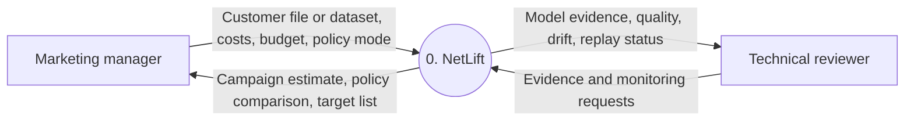
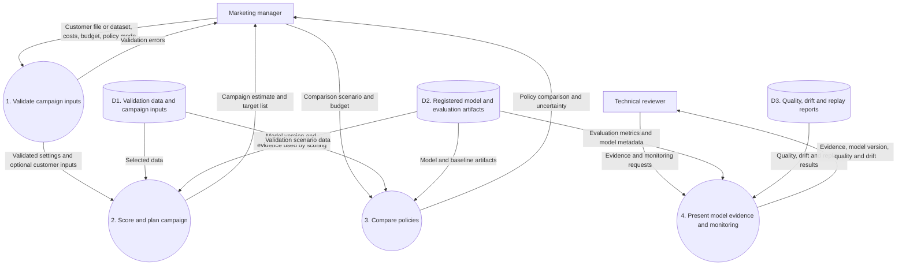

# T49 · Data flow and dashboard design

The Streamlit dashboard supports campaign planning and policy comparison, with model evidence and monitoring available in two further tabs. Put the decision and its uncertainty first. Keep the underlying metrics and run details within two clicks.

Sources: [Project specification](../NetLift_Project_Specification.tex), [scoring interface](interfaces.md), and the [proposed T45 API contract](https://github.com/mahmoud-nadeem/netlift/pull/112). The wireframes describe the intended T62 experience. Some evidence and replay panels require data beyond the T45 mock responses.

## Context DFD

## Level 1 DFD

These are logical stores. The dashboard reads through the API. Batch scoring feeds campaign planning, policy simulation feeds the comparison tab, and model-info and drift responses feed the evidence and monitoring tabs. Recorded replay results come from offline jobs. Comparison uses validation scenarios while test access is locked.

## Dashboard wireframes

### 1. Campaign Planner

| Area | Content |
| --- | --- |
| Setup | Customer file or dataset selector, cost per contact, margin per conversion, budget, policy mode, and **Run plan** |
| Decision summary | Contact count, expected incremental conversions with 95% interval, and expected incremental profit |
| Comparison sentence | Describe projected incremental conversions versus response targeting at the same number of contacts when the paired evidence is available |
| Results | Customer table with recommendation and verdict, row detail, and **Download target list** |

The target list reflects the selected policy mode. Show the policy action separately from the model recommendation when they differ. Keep exports scoped to the current successful run.

### 2. Policy Comparison

| Area | Content |
| --- | --- |
| Controls | Scenario, data slice, model version, and budget slider |
| Chart | Overlaid cumulative incremental conversion curves for uplift, response model, random and blanket where supported. Show bootstrap bands and one shared budget marker |
| Comparison table | Contacts, cost, incremental conversions with interval, incremental profit, and profit per unit spent |
| Conclusion | Paired uplift-minus-response difference and its interval. Use **No clear difference** when the interval includes zero |

Label full blanket contact at its actual cost. If that policy exceeds the selected budget, show it as a full-coverage reference and identify it as over budget.

### 3. Model Evidence

| Area | Content |
| --- | --- |
| Model header | Model version, evaluation dataset and split, and link to run details |
| Ranking evidence | Qini curve with confidence band, AUUC and Qini coefficient with intervals, and decile table |
| Diagnostic panels | Uplift calibration plot, SHAP summary, and negative-control result |
| Model comparison | Champion and challenger table, with evaluation settings and intervals |

Show **Evidence unavailable** for missing model artifacts. Mark preliminary point estimates as preliminary while intervals are pending.

### 4. Monitoring

| Area | Content |
| --- | --- |
| Status | Registered model version, training date, report timestamp, and data quality status |
| Drift | Feature drift and uplift-score drift where a reference comparison is available |
| Replays | Recorded campaign replay outcomes and dates |
| Delayed effect drift | Separate panel labelled **Simulated replay · not live** |

Show **No drift report available yet** for the empty state. Use a visible **Mock data** label on illustrative API responses.

## Customer detail and UI guidelines

Selecting a customer row opens its score, 95% uplift interval, segment label, recommendation, verdict and top drivers. Also show decile, expected incremental profit when available, model version and scoring timestamp. Label the interval as decile-level evidence so readers can interpret its scope.

| Verdict | Badge and message | Model recommendation |
| --- | --- | --- |
| `confident` | **Contact** or **Suppress** with a directional icon and the supporting interval. Positive intervals support contact, negative intervals support suppression | Display the returned `contact` or `suppress` action |
| `insufficient_evidence` | **Insufficient evidence** with a neutral badge. The uplift interval includes zero | `no_action` |
| `insufficient_control_data` | **Insufficient control data** with a warning badge. The segment lacks the required control evidence | `no_action` |

- Use text and icons alongside color. Keep both abstention labels visible in tables, customer detail, and relevant exports.
- Under suppression-only mode, `no_action` may be contacted under business as usual. Label that separately as **Business-as-usual contact**, with the original abstention verdict visible. Other modes leave these customers out of the contact list.
- Label uplift in percentage points, incremental conversions as counts, and profit and cost in the configured currency unit. Use consistent signs and units across screens.
- Validate inputs before submission. Show loading, empty, and error states with a clear next action. Indicate when displayed results belong to a previous run after inputs change.
- Use result labels consistently: **Measured**, **Preliminary**, **Mock data**, and **Unavailable**. Preserve the split, model version, and run or scenario identity alongside the corresponding result.
