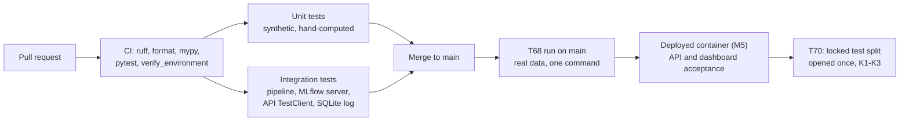

# Test plan

**Task:** T51 ([#63](https://github.com/mahmoud-nadeem/netlift/issues/63)) · **Owner:** Mazen (drafted by Mahmoud) ·
**Partner:** Ali · **Milestone:** M4, used through M5 and T70

This plan keys every test to a requirement ID in `docs/requirements/`: FR-01 to FR-53 in
`03-functional-requirements.md` and NFR-01 to NFR-08 in `04-non-functional-requirements.md`. It
maps the tests that exist today, and gives each missing test the task that owns it. The test names
proposed in the requirements table (`test_fr_NN_...`) are the names to use for new tests.

## 1. Test levels

| Level | What it checks | Where it runs | Data |
|---|---|---|---|
| Unit | One function or contract, including hand-computed metric fixtures and the frozen interfaces | `pytest -q` in CI on every pull request and push to `main` | Synthetic or hand-computed |
| Integration | Several modules together: pipeline to split to baseline, the tracking wrapper against a real MLflow server, the API through FastAPI's `TestClient`, the scoring log on SQLite | Same CI run | Synthetic; MLflow and SQLite started by the test |
| Acceptance | One requirement end to end on the built system | T68's run on `main`; the deployed container at M5; T70 for the locked test split | Real data; the dashboard by a checklist review |

Rules:

- New behaviour lands with its test in the same pull request.
- No test in CI reads `data/raw/`. Real-data runs belong to T68 and the acceptance checks.
- No test opens the locked test split. Only T70 does, once.
- A requirement marked Open or Proposed in the requirements table is tested against the proposed
  rule and changes with it.

## 2. Tests that exist

On `main` today, plus the T39 tests in #111 (`tests/unit/`).

| Requirement | Existing tests | What they cover | Still missing (owner) |
|---|---|---|---|
| FR-09 | `test_data_contracts`: `test_forbidden_column_is_rejected`, `test_forbidden_column_is_rejected_at_construction`; `test_data_pipeline`: `test_criteo_exposure_not_in_features_and_subsample_is_stratified` | `validate_features` names the forbidden column; `exposure` never reaches the features | The scoring endpoints (T59) |
| FR-10 | `test_data_contracts`: `test_nan_in_x_is_rejected`, `test_infinite_value_in_x_is_rejected`, `test_pandas_na_in_a_nullable_column_is_rejected`, `test_non_numeric_column_is_rejected`; `test_data_pipeline`: `test_hillstrom_schema_rejects_bad_data`, `test_criteo_schema_rejects_exposed_control`, `test_schema_rejects_non_numeric_feature` | Missing and infinite values, schema checks | Configured null-rate and range thresholds (T66); blocking at the endpoint (T59) |
| FR-11 | `test_api_schema`: `test_specification_example_round_trips_through_json`, `test_object_round_trips_through_dict`, `test_missing_and_unknown_keys_are_named` | The eleven fields, none missing or extra | Every row from both endpoints (T59) |
| FR-12, NFR-04 | `test_api_schema`: `test_decile_must_be_an_int_from_1_to_10`, `test_non_finite_score_is_rejected`, `test_reversed_interval_is_rejected`, `test_missing_and_unknown_keys_are_named` | A response cannot lack a verdict or carry an invalid score, interval or decile | Every endpoint response (T59) |
| FR-13 | `test_api_schema`: `test_straddling_interval_is_insufficient_evidence_with_no_action`, `test_abstention_never_carries_a_directional_recommendation`, `test_confident_needs_an_interval_that_excludes_zero` | The response refuses a directional recommendation with a straddling interval | The scoring path that assigns the verdict (T55) |
| FR-22 | `test_api_schema`: `test_values_outside_the_enumerations_are_rejected` | `segment_label` values | The dashboard wording (T62) |
| FR-30 | `test_api_schema`: `test_suppress_needs_an_upper_bound_below_zero`, `test_suppress_with_an_interval_below_zero_is_accepted`, `test_sleeping_dog_never_carries_contact` | The response side of the sleeping-dog rule | The policy engine's suppression list (T55) |
| FR-35 | `test_evaluation_contracts`: `test_indices_stay_within_arms`, `test_too_few_resamples_cannot_be_reported`; #111 `test_metrics`: `test_interval_is_the_percentile_interval_of_the_resamples` | Within-arm resampling, at least 1,000 resamples to report, percentile interval | Its use in the replay measurement (T61) |
| FR-43 | `test_evaluation_contracts`: `test_same_t_and_seed_give_the_same_fingerprint_and_a_paired_difference`, `test_validation_and_test_cannot_be_paired`; #111 `test_metrics`: `test_paired_difference_of_two_scorers_on_the_same_resamples` | The difference interval on shared resamples | The sentence that names a winner or none (T61) |
| FR-45 | `test_data_contracts`: `test_locked_test_split_opens_once`, `test_opening_needs_a_reason`, `test_only_the_test_split_can_be_locked`; `test_data_pipeline`: `test_test_split_stays_locked_after_build`; `test_baselines`: `test_training_membership_scores_and_locked_test` | The test split is locked and opens once with a reason | `POST /policy/simulate` refusing it (T61) |
| FR-07, FR-38 | `test_evaluation_contracts`: `test_full_result_is_attached_and_rebuilds_for_a_paired_comparison`, `test_a_run_logged_through_log_metric_result_is_reportable`; `test_tracking_server`: `test_wrapper_logs_a_run_to_a_real_server` | Result, seed, library and settings reach MLflow | The replay's own artefacts (T61) |
| FR-49 | `test_tracking`: `test_provenance_tags_are_recorded`, `test_seed_is_applied_not_merely_recorded`, `test_run_without_a_task_is_rejected` | Commit, dirty flag and seed are recorded | One command from config and a commit (T67) |
| FR-50 | `test_data_pipeline`: `test_split_disjoint_and_covers_all_rows`, `test_same_seed_same_split`, `test_assertion_fails_on_unstratified_part`; `test_data_contracts`: `test_split_does_not_depend_on_the_target`; `test_baselines` (7 tests); #111 `test_metrics` and `test_curves` | Schema, joint stratified split, baselines, metrics with intervals | The pipeline running the stages in order (T58) |
| FR-51 | The FR-09 tests; `test_baselines`: `test_rechecks_mutated_features` | A forbidden column cannot enter a matrix | The leakage audit enforced in CI (T58); the K4 gate (T43, #119) |
| NFR-08 | `.github/workflows/ci.yml` | The five checks on every pull request | — |

`test_criteo_complier_baseline`, `test_smoke` and the naming tests in `test_tracking` have no
requirement ID. They guard the methodology rules and the KPI configuration, and stay as they are.

## 3. Tests that are missing

Grouped by the task that builds the code, because the test lands with the code.

| Task (owner) | Requirements | Level |
|---|---|---|
| T55 decision layer (Ali) | FR-13 (verdict from the interval), FR-14, FR-17, FR-26, FR-27, FR-28, FR-29, FR-30 (suppression list), FR-33 | Unit |
| T61 simulator and replay job (Ali) | FR-01, FR-02, FR-03, FR-05, FR-06, FR-07, FR-31, FR-34, FR-35 (replay), FR-36, FR-37, FR-38, FR-39, FR-40, FR-43, FR-44, FR-45 (simulate) | Unit and integration |
| T65 behavioural and invariance tests (Ali) | FR-04: shuffling the outcome column changes no score and no allocation; NFR-07: bad input and repeated runs fail loudly or give the same result | Unit and integration |
| T58 production data pipeline (Aliaa) | FR-50 (stages in order), FR-51 (leakage audit in CI) | Integration |
| T66 data validation (Aliaa) | FR-10 (null-rate, range and schema-change checks from configuration), NFR-05 (`.env` is git-ignored; the dataset cards state that no personal data is held) | Unit |
| T60 scoring log (Aliaa) | FR-14 (threshold logged with the response), NFR-03 (every logged score has `model_version`) | Integration on SQLite |
| T59 FastAPI service and Docker (Mazen) | FR-08, FR-09, FR-10, FR-11, FR-12, FR-16, FR-18, FR-19, NFR-04 (endpoints); NFR-02 (latency) | Integration through `TestClient`; acceptance on the deployed container |
| T64 drift (Mazen) | FR-46 (PSI on the input features), FR-48 (report on demand) | Unit |
| T67 one command (Mazen) | FR-49, FR-53, NFR-01 | Acceptance, repeated by T68 |
| T62 dashboard (Mohammed) | FR-15, FR-20, FR-21, FR-22, FR-23, FR-24, FR-25, FR-32, FR-41, FR-42, FR-47, NFR-06 | Unit for the formatting helpers; acceptance by checklist review |
| T57 champion (Mahmoud) | FR-52 (registered with its evaluation, previous version kept) | Integration |
| T43 negative control (Ali, #119) | FR-51 (K4 gate) | Unit |

FR-46 also asks for score drift and the data-quality status. T64 builds PSI on the input features
only, so those two parts are not tested this semester.
