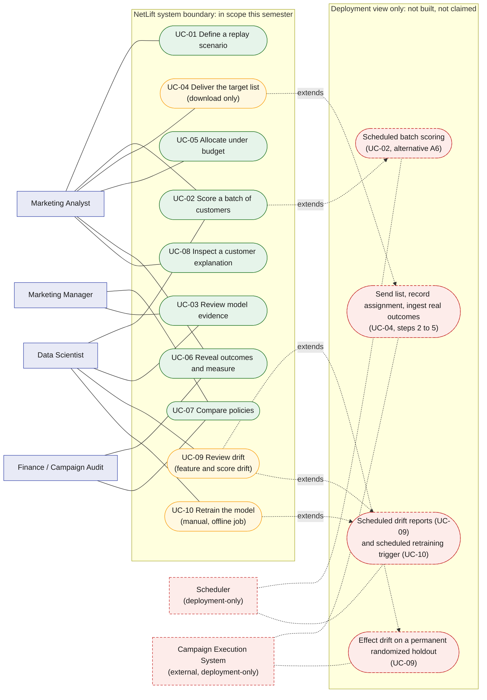
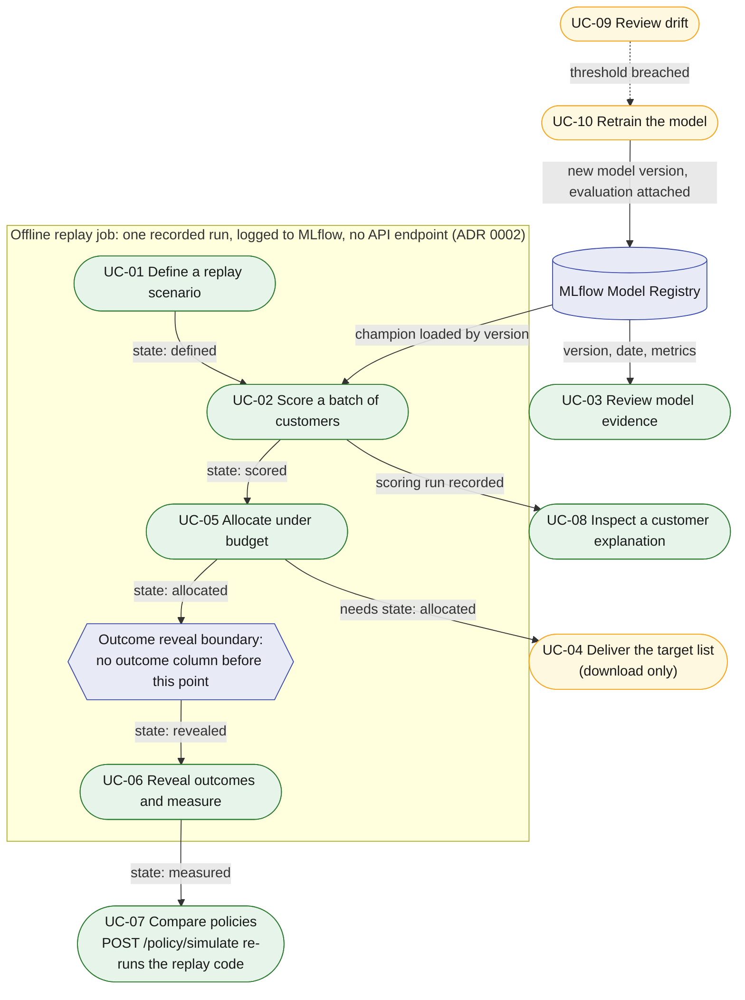

# Use case diagram and descriptions

Author: Ali Alaa · Task: T46 · Issue: #58 · Partner (reviewer): Mohammed Sherif · Milestone: M4 – System Analysis and Design
Status: Draft for review

Sources: `docs/requirements/02-user-stories-and-use-cases.md` (T32, revised 16 October 2026),
`docs/requirements/03-functional-requirements.md` (T33), ADR 0002 (PR #95) and
`NetLift_Project_Specification.pdf` (snapshot of 13 October 2026). Section numbers (§) are the PDF's.

This document is the design-phase form of the T32 use cases. It does not renumber or rename
anything: **UC-01 to UC-10, US-01 to US-10 and FR-01 to FR-53 are frozen** and keep their T32 / T33
meaning. Where T32 leaves a point open, the point keeps its **[Q#]** label and is not decided here.
Questions are listed in T32, Section 5.

---

## 1. Purpose and conventions

NetLift has no live users this semester. Both datasets are historical, public and de-identified, and
the "campaign" is a **simulated replay** over a held-out split (§14). The diagram and the
descriptions below therefore separate what is built from what a live deployment would need (§15).

### 1.1 Status legend

| Status | Meaning |
|---|---|
| **Built** | Built and exercised this semester |
| **Partly** | Part of it is built this semester; the rest is designed and documented only |
| **Deployment-only** | Not built and not claimed. Recorded because a live system would need it (§15) |

### 1.2 "Implemented in M4" versus "built this semester"

M4 (17 October – 6 November) is the design milestone. The plan builds the use cases themselves in
M5 (7 – 30 November, feature freeze 27 November). The status columns in this document therefore
use two separate questions, so nobody reads a design document as a claim that code exists:

| Question | Where it is answered |
|---|---|
| Is the use case in scope this semester, or deployment-only (§45)? | **Status** (Built / Partly / Deployment-only) |
| What exists by the end of M4? | **M4 groundwork**: the M4 tasks that the use case builds on, plus this design |

A use case counts as built only when the pull request for its M5 task is merged.

### 1.3 Terms used below

| Term | Meaning |
|---|---|
| Verdict | One of `confident`, `insufficient_evidence`, `insufficient_control_data` (§11, §12). Separate from `recommendation` on purpose. |
| Replay | Decide on a held-out slice without reading outcomes, then reveal and measure (§14). Not a live campaign. |
| Holdout (replay) | The selected customers whose *recorded* assignment was control. No random holdout is drawn (ADR 0002, **[Q10]**). |
| Holdout (deployment) | A permanent randomized share withheld before contact (§15). Deployment-only. |
| Policy mode | How the Uplift Policy selects customers: Fixed budget, Profit-maximising, Fixed target, Suppression-only (§10). Not the same thing as the four *policies compared* in UC-07 (Uplift, Response model, Blanket, Random). |
| ITT-scale uplift | The only uplift scale used by the decision layer and the simulator. The Wald estimate never enters m · τ̂ − c (§6, §10). |

---

## 2. Actors

Six actors, as in T32 (**[Q6]**: T31 and T46 must use the same names).

| Actor | Type | Role in NetLift | Status | Source |
|---|---|---|---|---|
| Marketing Analyst | Primary, human | Defines scenarios, sets cost, margin, budget and policy mode, scores customer lists, downloads the target list, inspects individual customers. Called "Retention / CRM analyst" in the target-user table. | Built | §1.5, §45 |
| Marketing Manager | Primary, human | Compares candidate policies on one screen before committing spend. | Built | §1.5 |
| Data Scientist | Primary, human | Calls the scoring API, reviews model evidence and drift, starts retraining runs. Called "Data science team" in the target-user table. | Built | §1.5, §45 |
| Finance / Campaign Audit | Secondary, human (reader) | Reads the incremental-profit report and the size of the holdout (the recorded control arm) behind it. Changes nothing. | Built | §1.5 |
| Scheduler | Supporting, internal system | Would start scheduled batch scoring, scheduled drift reports and the scheduled part of the retraining rule. | **Deployment-only** (working assumption **[Q7]**) | §45, §35, §32 |
| Campaign Execution System | External system | Would receive the approved target list, run the real campaign and return real outcomes after an outcome window. Does not exist in this project. | **Deployment-only** | §45, §15 |

Notes:

- MLflow Model Registry, the PostgreSQL scoring log and the FastAPI service are **components, not
  actors**. They appear in preconditions and flows only.
- The Scheduler is a secondary actor in UC-02, UC-09 and UC-10 and is never required for a flow to
  work this semester. The Campaign Execution System appears in UC-04 only.
- Mapping to T31 (stakeholders): "Campaign operations" is the human counterpart of the Campaign
  Execution System. It has no use case of its own, because nothing it does is built this semester.

---

## 3. Use case diagram

Mermaid has no native UML use-case diagram, so this is a `flowchart`: stadium shapes are use
cases, rectangles are actors, and the large box is the system boundary.

Legend: **green** = built this semester · **amber** = partly built · **red, dashed** =
deployment-only (not built, not claimed). A solid line is an association that works this semester;
a dashed line is a deployment-only association or an extension.

Reading the diagram:

- Every use case inside the boundary is built this semester, fully or partly. Nothing inside the
  boundary depends on the Scheduler or the Campaign Execution System.
- The four use cases marked "partly" are the ones that have a deployment-only extension: UC-04
  (delivery to a campaign system), UC-09 (effect drift, scheduled reports) and UC-10 (scheduled
  trigger). UC-02 is built in full; only its scheduled trigger (A6) is deployment-only.
- Secondary links not drawn, to keep the picture readable: Data Scientist is a secondary actor in
  UC-08, and Marketing Analyst in UC-07. They are listed in Section 4.

### 3.1 Dependencies between use cases

How the use cases hand over to each other. In a recorded run, UC-01, UC-02, UC-05 and UC-06 are
steps of **one offline replay job** (ADR 0002, decision 1), which is why the API has no endpoint for
them. The scenario state after each step is on the arrow.

Rules the diagram encodes:

1. **Reveal once.** Each scenario is revealed once. UC-06 refuses a reveal unless the state is
   `allocated` (FR-06). Measuring on different inputs needs a new scenario (UC-01) **[Q1]**.
2. **Re-run, not reuse.** UC-07 re-runs the replay code. It does not read the stored UC-06 result,
   and it leaves the scenario state and the stored result unchanged (ADR 0002, decision 2; FR-40,
   FR-44).
3. **Locked split.** No replay or simulate call re-opens the locked test split. It is opened once,
   through `LockedTestSplit.open(reason)`, under the T70 procedure (FR-45, **[Q1]**).

---

## 4. Use case summary

| ID | Use case | Primary actor | Secondary actors | Interface | Status | M4 groundwork | User stories | Functional requirements |
|---|---|---|---|---|---|---|---|---|
| UC-01 | Define a replay scenario | Marketing Analyst | none | Scenario configuration file, read by the offline replay job. No endpoint. | **Built** | Design only (this document, T47) | US-01 | FR-01 to FR-04 |
| UC-02 | Score a batch of customers | Marketing Analyst | Data Scientist; Scheduler (**deployment-only**) | `POST /score/batch`, `POST /score`, Dashboard Tab 1 | **Built** (scheduled trigger deployment-only) | T42 estimators; T45 API skeleton with mocked responses | US-02, US-03 | FR-08 to FR-18 |
| UC-03 | Review model evidence | Data Scientist | Marketing Manager | Dashboard Tab 3, `GET /model/info` | **Built** | T39 harness; T43 negative control; T45 mocked `/model/info` | US-09 | FR-19, FR-20 |
| UC-04 | Deliver the target list to a campaign | Marketing Analyst | Campaign Execution System (**deployment-only**) | Dashboard Tab 1 (download). No endpoint. | **Partly** | Design only | US-04 | FR-25, FR-33 |
| UC-05 | Allocate under budget | Marketing Analyst | none | Decision layer (`PolicyEngine`), called by the replay job | **Built** | T44 equal-budget top-k selection (K1, no suppression or abstention) | US-03, US-04 | FR-26 to FR-33 |
| UC-06 | Reveal outcomes and measure | Marketing Analyst | Finance / Campaign Audit | Offline command-line job, logged to MLflow; results shown in Tab 2 and Tab 4 | **Built** | T44 runs the first replay comparison on the validation split | US-05, US-07 | FR-05 to FR-07, FR-31, FR-34 to FR-39 |
| UC-07 | Compare policies | Marketing Manager | Marketing Analyst; Finance / Campaign Audit | Dashboard Tab 2, `POST /policy/simulate` | **Built** | T44 result; T45 mocked `/policy/simulate` | US-06, US-07 | FR-39 to FR-45 |
| UC-08 | Inspect a customer explanation | Marketing Analyst | Data Scientist | Dashboard customer detail, `POST /score` | **Built** | T36 frozen response schema | US-03, US-08 | FR-21 to FR-24 |
| UC-09 | Review drift | Data Scientist | Scheduler (**deployment-only**) | Dashboard Tab 4, `GET /monitor/drift` | **Partly** | T45 mocked `/monitor/drift` | US-09 | FR-46 to FR-48 |
| UC-10 | Retrain the model | Data Scientist | Scheduler (**deployment-only**) | Offline pipeline job and MLflow Model Registry. No endpoint. | **Partly** | T37 split and pipeline; T41 MLflow logging | US-10 | FR-49 to FR-53 |

The API stays at the six endpoints of §35 (ADR 0002). Every other trigger is a dashboard action or
an offline job. `GET /health` serves UC-02 (A7) and is otherwise an operational endpoint.

The eight use cases named in §45 are UC-01, UC-02, UC-05, UC-06, UC-07, UC-08, UC-09 and UC-10.
UC-03 and UC-04 are added because the dashboard (§40, Tab 3) and the Campaign Execution System
actor (§45) each need one.

---

## 5. Built versus deployment-only, flow by flow

This is the table behind the colours in the diagram. Where a use case is "partly" built, the
deployment-only flows are listed explicitly so that nothing is claimed by accident.

| Use case | Built this semester | Deployment-only (designed, not built) | Why |
|---|---|---|---|
| UC-01 | Scenario configuration, input validation, c/m report, scenario stored as `defined` | none | Fully inside the replay |
| UC-02 | Batch and single scoring, data-quality and forbidden-column checks, both abstention verdicts, scoring log | **A6:** scheduled run started by the Scheduler | The Scheduler is not built **[Q7]** |
| UC-03 | The whole view, read-only | none | Fully inside the project |
| UC-04 | Step 1: download the target list from Tab 1 | **Steps 2 to 5:** send the list to the Campaign Execution System, record assignment at assignment time, run the campaign, ingest real outcomes, measure the realised effect; **A1:** compliance and contamination handling | No Campaign Execution System and no permanent holdout exist (§15). UC-06 replaces steps 2 to 5 with recorded outcomes |
| UC-05 | All four policy modes, eligible pool, suppression list, abstention list, replay holdout record | A permanent randomized holdout withheld before contact | In the replay the holdout is the recorded control arm (ADR 0002, **[Q10]**) |
| UC-06 | The replay: reveal once, measure with within-arm bootstrap, four policies, K3 profit, K5 calibration, MLflow run | A live campaign with a real outcome window | The datasets are historical; every outcome is already in the file (§14) |
| UC-07 | Re-run of the replay code for a given budget, cost and margin; table, curves with bands, headline sentence | none | Fully inside the replay |
| UC-08 | The whole view | none | Fully inside the project |
| UC-09 | Feature drift (PSI or KS), score drift, data-quality status, on-demand drift report, model version and replay results, effect-drift panel **mocked and labelled as such** | **Effect drift** on a permanent holdout after a real outcome window; early-proxy outcome; calibration after an outcome window; **scheduled** report generation | Needs a holdout and an outcome window that do not exist here (§32, **[Q7]**) |
| UC-10 | Manual retraining run: the reproducible pipeline run again, candidate registered with its evaluation, previous version kept for rollback | **Scheduled trigger** (cadence or drift threshold starting the run automatically); retraining on real outcomes | The Scheduler is not built **[Q7]**; promotion rule is open **[Q9]** |

---

## 6. Use case descriptions

Every use case states how both abstention verdicts are handled, or why they cannot arise there.
"Spec basis" gives PDF section numbers.

### UC-01 Define a replay scenario

- **Primary actor:** Marketing Analyst. **Secondary actors:** none.
- **Interface:** scenario configuration file, read by the offline replay job (UC-06). No API
  endpoint (ADR 0002). Stored as `replay_scenario`.
- **Preconditions:**
  1. A champion model is registered in the MLflow Model Registry.
  2. A held-out slice exists that can stand in for "next month's campaign" (§14). Which split is
     allowed at which stage is open **[Q1]**; until Q1 is decided, replays use only the validation
     split (ADR 0002, FR-45).
  3. The analyst can run the replay job from the command line **[Q3(a)]**.
  4. The policy mode is set in the configuration. **Proposed [Q12]:** default is Fixed budget; Fixed
     target requires N.
- **Main flow:**
  1. The analyst writes the scenario configuration: dataset, and the slice of the held-out split that
     stands in for the audience.
  2. The configuration holds the cost per contact c, the margin per conversion m, the budget, the
     policy mode, and N when the mode is Fixed target.
  3. The system validates the inputs: c, m and budget are numbers greater than zero, a slice is selected.
  4. The job reports the break-even ratio c/m.
  5. The system stores the scenario and the slice membership, and withholds the outcome column from
     everything that follows until the reveal step of UC-06.
  6. The system sets the scenario state to `defined`.
- **Alternative flows:**
  - A1. *Missing or invalid input:* the configuration is rejected, the input is named, no scenario is created.
  - A2. *An outcome column is found in a frame handed to a step before the reveal:* the run is invalid and the guarding test fails (§14).
  - A3. *Abstention verdicts:* not applicable. Nothing is scored yet; both verdicts first arise in UC-02.
- **Postconditions:** a scenario in state `defined`; c, m, budget and slice recorded; no outcome read.
- **Status:** Built. **Stories:** US-01. **Requirements:** FR-01 to FR-04.
- **Spec basis:** §10, §14 (step 1), §45.

### UC-02 Score a batch of customers

- **Primary actor:** Marketing Analyst. **Secondary actors:** Data Scientist (calls the API directly);
  Scheduler (scheduled runs, **deployment-only**).
- **Interface:** `POST /score/batch` (CSV or JSON array → scored file and summary); `POST /score`
  (one customer → full response object); Dashboard Tab 1.
- **Preconditions:**
  1. A champion is registered and loaded by version at start-up (§35).
  2. The preprocessing artefacts, fitted on the training fold only, are available (§23).
  3. The input has permitted feature columns only: no treatment indicator, no outcome, no `exposure`.
  4. In a replay, the scenario is `defined`.
- **Main flow:**
  1. The analyst submits a customer file, or one customer.
  2. The system checks data quality: null rates, range violations, schema changes (§32).
  3. The system runs `validate_features()`, the forbidden-column check (§18).
  4. The system applies the stored preprocessing and scores each customer: `uplift_score`, a 95%
     bootstrap interval `uplift_ci_95`, and `decile`.
  5. The abstention logic assigns a `verdict` to every customer.
  6. The system fills `customer_id`, `model_version`, `segment_label`,
     `expected_incremental_profit` (m · uplift − c), `recommendation`, `top_drivers`, `scored_at`.
     Where m and c come from outside a scenario is open **[Q4]**.
  7. The system returns the scored file and summary (or one response object) and writes the scoring
     run to the scoring log.
  8. In a replay, the scenario state becomes `scored`.
- **Alternative flows:**
  - A1. *Forbidden column present:* the run is rejected, the column is named, no row is scored (K7).
  - A2. *Data-quality failure or malformed input:* the run is blocked with an error; no partial result is presented as valid.
  - A3. *`insufficient_evidence`:* the 95% interval straddles zero. The score and interval are still
    returned, no directional recommendation is issued, and the estimate is not rounded to a decision
    (§11). **Proposed [Q2]:** `recommendation` = `no_action`, `segment_label` = `unknown`.
  - A4. *`insufficient_control_data`:* the segment holds fewer than the configured minimum number of
    control-group outcome events. The threshold used is logged with the response (§11). Same
    proposal for `recommendation` and `segment_label` **[Q2]**.
  - A5. *Single customer:* `POST /score` returns one full response object.
  - A6. *Scheduled run:* **deployment-only.** The Scheduler would start the same flow without an analyst **[Q7]**.
  - A7. *Model not available:* `GET /health` reports not ready and no score is returned.
- **Postconditions:** every returned row has all eleven schema fields, including a `verdict`; the run
  is in the scoring log; in a replay the scenario is `scored`.
- **Status:** Built (A6 deployment-only). **Stories:** US-02, US-03. **Requirements:** FR-08 to FR-18.
- **Spec basis:** §11, §12, §18, §32, §35, §45.

### UC-03 Review model evidence

- **Primary actor:** Data Scientist. **Secondary actors:** Marketing Manager (reads the same screen).
- **Interface:** Dashboard Tab 3 (Model Evidence); `GET /model/info`.
- **Preconditions:**
  1. A champion is registered with its evaluation attached to the version (§32).
  2. The evaluation harness has produced Qini, AUUC and uplift@k with bootstrap intervals, and the
     negative-control result exists (§27, §28).
- **Main flow:**
  1. The Data Scientist opens Model Evidence.
  2. The system calls `GET /model/info` and shows the registered version, training date and metrics with intervals.
  3. The system shows the Qini curve with a confidence band, AUUC and Qini coefficient with
     intervals, the decile table, the uplift calibration plot, the SHAP summary, the negative-control
     result and the champion–challenger table (§40).
  4. The system names the library and settings used for Qini and AUUC, and the number of bootstrap resamples.
- **Alternative flows:**
  - A1. *Negative control fails:* K4 is shown as **fail** and is not hidden (§28).
  - A2. *Champion and challenger not distinguishable:* the difference distribution straddles zero; the screen says so and names no winner (§28).
  - A3. *`insufficient_evidence`:* a decile or segment whose interval straddles zero is shown in the abstention style, not as an effect (§11).
  - A4. *`insufficient_control_data`:* a decile or segment with too few control events is shown as such, not as an estimate (§11).
  - A5. *No registered model:* `GET /model/info` returns an error and the tab says so.
- **Postconditions:** read-only.
- **Status:** Built. **Stories:** US-09. **Requirements:** FR-19, FR-20.
- **Spec basis:** §27, §28, §29, §31, §35, §40.
- **Note (K2):** the K2 pass condition is an interval *entirely above* zero, per `config/kpis.yaml`;
  §46 says only "excludes zero" **[Q11]**.

### UC-04 Deliver the target list to a campaign

- **Primary actor:** Marketing Analyst. **Secondary actors:** Campaign Execution System
  (**external, deployment-only**).
- **Interface:** Dashboard Tab 1 (downloadable target list). No endpoint exists for the
  deployment-only steps **[Q3]**.
- **Preconditions:**
  1. The scenario is `allocated` (UC-05): a target list and a suppression list exist.
  2. For the deployment-only steps: a Campaign Execution System is connected and a permanent
     randomized holdout is maintained (§15).
- **Main flow:**
  1. The analyst downloads the target list. *(Built.)*
  2. *(Deployment-only.)* The system sends the list to the Campaign Execution System and records who
     was assigned to which arm at assignment time.
  3. *(Deployment-only.)* The Campaign Execution System runs the campaign.
  4. *(Deployment-only.)* After the outcome window closes, it returns real outcomes and the system ingests them.
  5. *(Deployment-only.)* The measurement job computes the realised effect in aggregate against the permanent holdout.
  - In this project, steps 2 to 5 are **replaced by UC-06**, which reveals recorded outcomes. This is a
    replay, not a live campaign, and the project does not claim otherwise (§14, §15).
- **Alternative flows:**
  - A1. *Assigned is not received:* the estimate stays intention-to-treat; compliance and contamination handling is deployment-only (§6, §15).
  - A2. *Outcome window not yet closed:* the realised effect cannot be computed; only feature and score drift are available (§32).
  - A3. *Abstention verdicts:* customers with either verdict are not eligible in UC-05, so they are not on the contact list. They are reported separately, so "do not contact" and "we do not know" are not merged (§12). How they are labelled in the exported file is open **[Q2]**.
- **Postconditions:** *(Built)* a downloadable target list. *(Deployment-only)* assignment and holdout
  membership recorded, outcomes ingested.
- **Status:** Partly. **Stories:** US-04. **Requirements:** FR-25, FR-33.
- **Spec basis:** §6, §14, §15, §40, §43, §44, §45.

### UC-05 Allocate under budget

- **Primary actor:** Marketing Analyst. **Secondary actors:** none.
- **Interface:** the decision layer (`PolicyEngine`), called by the replay job in a recorded run
  (ADR 0002). No endpoint of §35 returns an allocation. Whether Tab 1 also calls it for an
  interactive allocation is open **[Q3(b)]**.
- **Preconditions:**
  1. The scenario is `scored` (UC-02): every customer has an estimate, an interval and a verdict.
  2. c, m and the budget B are known (UC-01).
  3. The scenario configuration has a policy mode (UC-01).
- **Main flow:**
  1. The job reads the policy mode from the scenario configuration and applies it (§10):
     *Fixed budget* (top k by estimated uplift, k = B / c, no selection of an estimate ≤ 0, budget
     may stay unspent); *Profit-maximising* (every customer with uplift > c/m; budget is an output);
     *Fixed target* (smallest set expected to deliver N incremental conversions, with the budget
     required and its uncertainty); *Suppression-only* (everyone except negative-uplift customers).
  2. The decision layer builds the **eligible pool**: customers whose verdict is `confident`.
     Abstained customers are reported separately and never used to fill k. **Proposed [Q2].**
  3. The mode is applied to the eligible pool on the **ITT-scale uplift**. The Wald estimate never
     enters m · uplift − c (§10, §6).
  4. The sleeping-dog rule: a customer whose estimated uplift is negative **and** whose interval
     lies entirely below zero goes on the suppression list and is never contacted, in any mode (§10).
  5. The system records the **replay holdout**: after the target list is fixed, the recorded
     treatment indicator is joined to the selected customers. Those recorded as control form the
     holdout; those recorded as treated form the contacted group. No random holdout is drawn
     (ADR 0002, FR-31). Scoring and allocation never receive the outcome (FR-04).
  6. The system shows the contact count, expected incremental conversions with an interval, expected
     incremental profit, and a line comparing the policy with targeting by response score (§40).
  7. The scenario state becomes `allocated`.
- **Alternative flows:**
  - A1. *k = 0, or every estimated uplift ≤ 0:* the target list is empty; under Fixed budget the budget stays unspent.
  - A2. *Fixed target N cannot be reached:* behaviour not specified **[Q5]**.
  - A3. *`insufficient_evidence`:* the customer is not in the eligible pool, is shown in the abstention style and is listed separately (§11).
  - A4. *`insufficient_control_data`:* treated the same way; the configured threshold is logged (§11).
  - A5. *Suppression versus abstention:* a customer with a negative point estimate whose interval
    straddles zero is not on the suppression list (the rule needs the interval entirely below zero),
    and is not selected either. The selection floor and the suppression list are two mechanisms **[Q2]**.
  - A6. *Eligible pool smaller than k:* fewer than k are contacted. The contact count and unspent
    budget are reported next to every figure, and the baseline policies of UC-06 still use the same k **[Q2]**.
- **Postconditions:** scenario `allocated`; target list, suppression list, abstention list and
  holdout record stored; steps 1 to 5 never touched the outcome column, and a test asserts it (§14).
- **Status:** Built. **Stories:** US-03, US-04. **Requirements:** FR-26 to FR-33.
- **Spec basis:** §5, §10, §11, §14, §15, §40.

### UC-06 Reveal outcomes and measure

- **Primary actor:** Marketing Analyst. **Secondary actors:** Finance / Campaign Audit (reads the result).
- **Interface:** offline command-line job (replay job), logged to MLflow. No endpoint (ADR 0002).
  Recorded runs are shown in Tab 2 and Tab 4. Who runs the command is open **[Q3(a)]**.
- **Preconditions:**
  1. A valid scenario configuration exists and a champion is registered.
  2. One run covers §14 steps [1] to [8]: before the reveal the job runs UC-01, UC-02 and UC-05, and
     none of them reads the outcome column.
  3. The slice may be revealed at this stage of the project **[Q1]**.
- **Main flow:**
  1. The analyst starts the replay job with the scenario configuration.
  2. The job runs UC-01, UC-02 and UC-05 (states `defined`, `scored`, `allocated`) without the outcome column.
  3. The job checks the scenario is `allocated` and not revealed before, then reads the recorded
     outcomes for the first time. State: `revealed`.
  4. For each policy, the job measures the incremental effect as the treated rate minus the control
     rate (the holdout) with a 95% bootstrap interval resampled **within treatment arms**, at least 1,000 resamples.
  5. The job replays the four policies at an identical budget: uplift (policy mode from the config),
     response model, blanket contact (reference at k = N) and random contact. For each: contact
     count, total cost, predicted and measured incremental conversions with intervals, incremental
     profit, profit per unit spent, and cumulative curves with bootstrap bands.
  6. The job converts the result to incremental profit with the stated cost and margin (K3) and
     records predicted-versus-measured differences per decile (K5).
  7. The job stores the result with the scenario (tables, curves, intervals, holdout size, library
     and settings, bootstrap seed), logs the run to MLflow and sets the state to `measured`.
- **Alternative flows:**
  - A1. *Reveal requested when the state is not `allocated`:* refused, including when the scenario was already revealed or measured.
  - A2. *`insufficient_evidence`:* a measured effect whose 95% interval contains zero is reported as not distinguishable from zero, in the abstention style (§11, K1).
  - A3. *`insufficient_control_data`:* a policy or decile whose holdout has too few control events is reported as such, and no effect is claimed. On Criteo the holdout is only the recorded control share of the selection, about 15%, so this is an expected outcome **[Q10]**.
  - A4. *Outcome leak detected:* if the "no outcome column before the reveal" test fails, the run is invalid and its result is not reported (§14).
- **Postconditions:** scenario `measured`; stored result and calibration record; run in MLflow. Every
  figure is an *estimated* incremental effect on held-out experimental data, not realised money (§13).
- **Status:** Built, as a simulated replay run as an offline job. A live campaign is deployment-only (UC-04, §15).
- **Stories:** US-05, US-07. **Requirements:** FR-05 to FR-07, FR-31, FR-34 to FR-39.
- **Spec basis:** §13, §14, §28, §35, §46 (K1, K3, K5).

### UC-07 Compare policies

- **Primary actor:** Marketing Manager. **Secondary actors:** Marketing Analyst; Finance / Campaign Audit.
- **Interface:** Dashboard Tab 2 (Policy Comparison); `POST /policy/simulate`, which **re-runs** the
  replay code (ADR 0002, decision 2). It does not read a stored UC-06 result.
- **Preconditions:**
  1. The scenario is `measured` (UC-06). Tying a simulate call to a recorded scenario is **Proposed**;
     the request fields beyond budget, cost and margin are open **[Q3(c)]**, deferred to T45.
  2. The champion and the response-model baseline both took part in that result.
  3. The scenario's slice is not the locked test split **[Q1]**.
- **Main flow:**
  1. The Marketing Manager opens Policy Comparison and selects a measured scenario.
  2. The system calls `POST /policy/simulate` with the budget, cost and margin. The endpoint re-runs
     the replay code with the recorded seed and returns the comparison table.
  3. The system shows one table: contact count, total cost, incremental conversions with an interval,
     incremental profit and profit per unit spent for each policy, with the holdout size behind each figure.
  4. The system shows overlaid cumulative-incremental curves with bootstrap bands.
  5. The budget slider moves one vertical line across all returned curves without a new call.
     Changing the budget, cost or margin used for the table is a new call, and the new assumptions
     are named on the same line as the figure.
  6. The system states the headline comparison in words, with its interval (K1).
- **Alternative flows:**
  - A1. *`insufficient_evidence`:* the 95% interval of the difference (uplift minus response model)
    contains zero. The screen says the policies are not distinguishable on this data and names no
    winner. A reportable finding, not a failed project (K1). Applying the abstention state to a
    policy-level figure extends §11 **[Q2(d)]**.
  - A2. *`insufficient_control_data`:* a policy whose holdout has too few control events is shown in the abstention style, not as a number.
  - A3. *Profit shown as money saved:* not allowed. Every profit figure is labelled estimated, with cost and margin on the same line (§13, K3).
  - A4. *Scenario not yet `measured`:* the screen says the comparison does not exist yet and points to UC-06. No re-run starts.
  - A5. *Scenario on the locked test split:* the re-run is refused; only the figures UC-06 stored are shown **[Q1]**.
- **Postconditions:** read-only. The scenario state and the stored UC-06 result are unchanged, and
  the call creates no recorded run.
- **Status:** Built. **Stories:** US-06, US-07. **Requirements:** FR-39 to FR-45.
- **Spec basis:** §13, §14, §28, §40, §46 (K1, K3).

### UC-08 Inspect a customer explanation

- **Primary actor:** Marketing Analyst. **Secondary actors:** Data Scientist.
- **Interface:** dashboard customer detail view; `POST /score` returns the same object.
- **Preconditions:** the customer has been scored (UC-02) and the scoring run is recorded.
- **Main flow:**
  1. The analyst selects a customer row.
  2. The system shows the full response object: `customer_id`, `model_version`, `uplift_score`,
     `uplift_ci_95`, `decile`, `segment_label`, `expected_incremental_profit`, `recommendation`,
     `verdict`, `top_drivers`, `scored_at` (§12).
  3. The system shows `segment_label` as one of `persuadable`, `sure_thing`, `lost_cause`,
     `sleeping_dog`, `unknown`, and states that it is an inference, never ground truth (§12).
  4. The system describes `top_drivers` as features that drive the model's uplift prediction, never as causes (§31).
- **Alternative flows:**
  - A1. *`insufficient_evidence`:* score and interval shown; the verdict is rendered in the distinct abstention style, with no directional recommendation (§11, §40).
  - A2. *`insufficient_control_data`:* the same distinct style; the threshold used is visible from the log (§11).
  - A3. *Unknown customer:* not in the scoring run; the view reports it.
  - A4. *Criteo:* drivers name anonymised features (`f0` to `f11`); a plain-language description is possible on Hillstrom only (§29, §52).
  - Whether `segment_label` becomes `unknown` under A1 and A2 is open (**Proposed:** yes) **[Q2]**.
- **Postconditions:** read-only.
- **Status:** Built. **Stories:** US-03, US-08. **Requirements:** FR-21 to FR-24.
- **Spec basis:** §11, §12, §31, §40.

### UC-09 Review drift

- **Primary actor:** Data Scientist. **Secondary actors:** Scheduler (would produce reports on a
  schedule; **deployment-only**).
- **Interface:** Dashboard Tab 4 (Monitoring); `GET /monitor/drift`.
- **Preconditions:**
  1. A training reference distribution is stored.
  2. A scored batch exists and a drift report has been produced from it. This semester the report is
     produced **on demand**; scheduled generation is deployment-only **[Q7]**.
  3. Alert thresholds are set in configuration (§32).
- **Main flow:**
  1. The Data Scientist opens Monitoring.
  2. The system calls `GET /monitor/drift` and shows the latest report.
  3. The system shows feature drift (PSI or KS per feature against the training reference), score
     drift, and data-quality status (null rates, range violations, schema changes).
  4. The system shows the registered model version, its training date and the results of each simulated replay.
  5. The system shows the effect-drift panel, **mocked from replay output and labelled as such**.
- **Alternative flows:**
  - A1. *Threshold breached:* an alert is raised. The retraining rule may lead the Data Scientist to start UC-10.
  - A2. *Data-quality failure:* the scoring run is blocked (§32).
  - A3. *No drift report yet:* the tab says so. The response of `GET /monitor/drift` in this case is not specified.
  - A4. *Abstention verdicts:* not produced by the drift monitors. They appear only where the
    effect-drift panel shows a replay's measured effect: an interval containing zero is shown as
    `insufficient_evidence`, too few control events as `insufficient_control_data`.
- **Postconditions:** read-only.
- **Status:** Partly. Feature drift, score drift and data-quality status are built and run on
  historical data split by time or on a simulated shifted population. **Effect drift** needs a
  permanent randomized holdout and a real outcome window and is **deployment-only**; the
  early-proxy outcome and calibration after an outcome window are designed and documented, not
  implemented. Scheduled report generation is deployment-only.
- **Stories:** US-09. **Requirements:** FR-46 to FR-48.
- **Spec basis:** §15, §32, §35, §40.

### UC-10 Retrain the model

- **Primary actor:** Data Scientist. **Secondary actors:** Scheduler (scheduled cadence;
  **deployment-only**).
- **Interface:** offline pipeline job and the MLflow Model Registry. No endpoint (ADR 0002).
- **Preconditions:**
  1. A documented retraining rule exists: cadence reached **or** drift threshold breached, either
     being enough (§32). The OR reading is **Proposed [Q9]**.
  2. The pipeline is reproducible from a configuration file and a git commit hash (§33, K8).
  3. Data for the new run is available.
- **Main flow:**
  1. A trigger arises: a drift threshold is breached (UC-09) or the cadence date is reached. This
     semester the Data Scientist starts the run by hand.
  2. The pipeline re-runs: schema validation, leakage audit, joint stratified split, baselines first,
     uplift estimators, evaluation with bootstrap intervals (§23).
  3. The candidate is compared with the current champion on the same bootstrap resamples (§28).
  4. The candidate is logged to MLflow as a new registered model version with its evaluation attached;
     the model lifecycle runs `registered` → `staging` → `production` → `archived` (§45).
  5. The API loads the model version selected at start-up and returns it in every response (§35).
- **Alternative flows:**
  - A1. *Forbidden column reaches the model matrix:* the pipeline fails (K7).
  - A2. *Negative control fails:* the candidate does not pass K4.
  - A3. *Candidate not distinguishable from the champion:* the difference distribution straddles zero (§28). The promotion rule is not specified **[Q9]**; nothing is promoted automatically.
  - A4. *Rollback:* the previous version stays registered, so a rollback is a version pin (§45).
  - A5. *Abstention verdicts:* not produced by retraining itself. The new version's evaluation reports
    intervals, and any decile with an interval straddling zero or too few control events is reported
    as `insufficient_evidence` or `insufficient_control_data` (UC-03).
- **Postconditions:** a new registered version with its evaluation attached; the previous version retained.
- **Status:** Partly **[Q9]**. The retraining rule is documented and a run is the same reproducible
  pipeline started by the Data Scientist. The automatic trigger driven by a Scheduler, and retraining on
  real outcomes, are **deployment-only**.
- **Stories:** US-10. **Requirements:** FR-49 to FR-53.
- **Spec basis:** §15, §28, §32, §33, §35, §45.

---

## 7. Traceability

### 7.1 Use case ↔ actors

| | Marketing Analyst | Marketing Manager | Data Scientist | Finance / Audit | Scheduler | Campaign Execution System |
|---|:-:|:-:|:-:|:-:|:-:|:-:|
| UC-01 | P | | | | | |
| UC-02 | P | | S | | S (dep.) | |
| UC-03 | | S | P | | | |
| UC-04 | P | | | | | S (dep.) |
| UC-05 | P | | | | | |
| UC-06 | P | | | S | | |
| UC-07 | S | P | | S | | |
| UC-08 | P | | S | | | |
| UC-09 | | | P | | S (dep.) | |
| UC-10 | | | P | | S (dep.) | |

P = primary · S = secondary · (dep.) = deployment-only.

### 7.2 Use case ↔ story ↔ requirement ↔ specification

| Use case | User stories | Functional requirements (T33) | Dashboard | API / job | Spec § | Status |
|---|---|---|---|---|---|---|
| UC-01 | US-01 | FR-01 to FR-04 | none (configuration file) | offline replay job | 10, 14, 45 | Built |
| UC-02 | US-02, US-03 | FR-08 to FR-18 | Tab 1 | `POST /score/batch`, `POST /score`, `GET /health` | 11, 12, 18, 32, 35 | Built (scheduled trigger deployment-only) |
| UC-03 | US-09 | FR-19, FR-20 | Tab 3 | `GET /model/info` | 27, 28, 29, 31, 40 | Built |
| UC-04 | US-04 | FR-25, FR-33 | Tab 1 (download) | none | 6, 14, 15, 43, 44 | Partly |
| UC-05 | US-03, US-04 | FR-26 to FR-33 | Tab 1 (interactive use open [Q3]) | decision layer, called by the replay job | 5, 10, 11, 14, 15 | Built |
| UC-06 | US-05, US-07 | FR-05 to FR-07, FR-31, FR-34 to FR-39 | Tab 2, Tab 4 (recorded runs) | offline replay job, logged to MLflow | 13, 14, 28, 35, 46 | Built |
| UC-07 | US-06, US-07 | FR-39 to FR-45 | Tab 2 | `POST /policy/simulate` | 13, 14, 28, 35, 40, 46 | Built |
| UC-08 | US-03, US-08 | FR-21 to FR-24 | Customer detail | `POST /score` | 11, 12, 31, 40 | Built |
| UC-09 | US-09 | FR-46 to FR-48 | Tab 4 | `GET /monitor/drift` | 15, 32, 40 | Partly |
| UC-10 | US-10 | FR-49 to FR-53 | none | offline pipeline job | 15, 28, 32, 33, 45 | Partly |

Coverage check: every use case is reached by at least one story and carries at least one functional
requirement. The test names for these requirements are the planned names in T33 and are not claims
that tests exist yet.

### 7.3 KPI touch points

| KPI | Use case where it is produced or shown |
|---|---|
| K1 (incremental conversions versus the response model) | UC-06 (measured), UC-07 (stated in words) |
| K2 (Qini coefficient and AUUC) | UC-03 |
| K3 (incremental profit per unit of spend) | UC-06, UC-07 |
| K4 (negative control) | UC-03 (shown), UC-10 (gate) |
| K5 (calibration) | UC-06 |
| K7 (leakage control) | UC-02 (A1), UC-10 (A1) |
| K8 (reproducibility) | UC-10 |

---

## 8. Open points that touch this document

None of these is decided here. The full text is in T32, Section 5, and in T33, Section 5.

| ID | Point | Affects |
|---|---|---|
| Q1 | Which split each replay uses at each stage; interim rule: validation split only, locked split opened once at T70 | UC-01, UC-06, UC-07 |
| Q2 | `recommendation`, `segment_label` and eligibility under abstention; selection floor versus suppression list; policy-level abstention | UC-02, UC-04, UC-05, UC-07, UC-08 |
| Q3 | Who runs the replay command; interactive allocation in Tab 1; request fields of `POST /policy/simulate` (deferred to T45, #57); how Tabs 2 and 4 read recorded runs | UC-04, UC-05, UC-06, UC-07 |
| Q4 | Source of m and c for standalone scoring | UC-02 |
| Q5 | Fixed target when N cannot be reached | UC-05 |
| Q6 | Actor names shared with T31 | Section 2 |
| Q7 | Scheduler confirmed as deployment-only; drift reports on demand | UC-02, UC-09, UC-10 |
| Q9 | Retraining trigger (OR) and promotion rule | UC-10 |
| Q10 | Replay holdout is the recorded control arm (decided in ADR 0002); effect scaling to k is for T44 | UC-05, UC-06 |
| Q11 | K2 pass condition: interval entirely above zero | UC-03 |
| Q12 | Default policy mode; Fixed target without N | UC-01, UC-05 |
