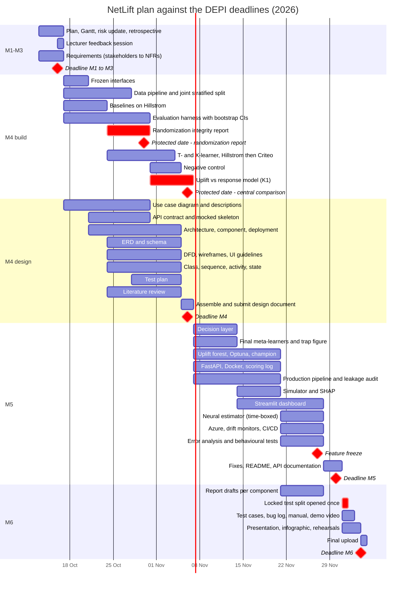

# Project plan

**NetLift — A Causal Decision System for Incremental Profit Optimization**

DEPI Microsoft Machine Learning Engineer Track · graduation project
Team leader: Mahmoud Nadeem · five members

This is the committed project plan required by the DEPI documentation checklist: timeline (Gantt
chart), milestones, deliverables and resource allocation. It is the version of record. Where it
disagrees with any slide, message or older document, this file wins. How the team works day to
day is in [`working-agreement.md`](working-agreement.md).

**Revised 13 October 2026.** The first version planned in programme weeks, with seven milestones
and a final presentation in Week 21. DEPI has since published fixed deadlines: six phases, final
submission on **4 December 2026**. This revision plans against those dates.

---

## 1. Deadlines

DEPI's deadlines are fixed and external. Every GitHub milestone carries its DEPI date as the due
date. Internally, everything for a deadline is in an open pull request by **23:59 the day
before**, so the deadline day itself is for review, merging and uploading only.

| GitHub milestone | DEPI phase | DEPI deadline | Internal deadline |
|---|---|---|---|
| M1 - Project Planning and Management | Project Planning & Management | Fri 16 Oct 2026 | Thu 15 Oct |
| M2 - Literature Review | Literature Review | Fri 16 Oct 2026 | Thu 15 Oct |
| M3 - Requirements Gathering | Requirements Gathering | Fri 16 Oct 2026 | Thu 15 Oct |
| M4 - System Analysis and Design | System Analysis & Design | Fri 6 Nov 2026 | Thu 5 Nov |
| M5 - Implementation | Implementation (Source Code & Execution) | Mon 30 Nov 2026 | Fri 27 Nov (feature freeze) |
| M6 - Testing, Final Presentation and Reports | Final Presentation & Testing & Reports | Fri 4 Dec 2026 | Thu 3 Dec |

The instructor confirmed on 13 October that the Literature Review phase is a feedback session with
him on 16 October, not a graded deliverable. The written literature review therefore moves to M4,
where it informs the design and later becomes the related-work section of the final report.

DEPI requires all documents on GitHub. The complete repository is pushed to the company
repository at every deadline, not only at the end.

---

## 2. Timeline

### Two protected dates

**Friday 30 October — randomization integrity report on both datasets.** Standardized mean
differences between arms and a treatment-predictability AUC. If the randomization is not what the
publications claim, every later result rests on it, and the team must know before modelling, not
after.

**Friday 6 November — uplift versus response model at equal budget, with an interval (KPI K1).**
A response model is the honest baseline. If uplift modelling does not beat it on this data, that
is a finding the project reports and investigates. Found on 6 November there are three weeks to
investigate it; found on 1 December there is nothing to say about it.

Everything else in the timeline can slip by a few days without damage. These two cannot.

---

## 3. What changed, and what was cut

The final submission moved from mid-January to 4 December: roughly six weeks fewer. Three things
change as a result.

**Testing is written with the code in M5; M6 keeps a dedicated window for opening the locked test
split once and the test report.** Every pull request in M5 keeps CI green. The rest of M6 is the
final presentation and reports.

**Implementation and design overlap.** M4 is a design milestone, but the data pipeline, the split,
the evaluation harness and the first estimators are built inside it, because the central comparison
is due at its end.

**Scope.** Decided against the specification's scope-control order:

| Item | Decision |
|---|---|
| Every MUST HAVE in the specification | Kept, unchanged |
| Confidence intervals, negative control, locked test split, response-model baseline | Never cut, at any level of pressure |
| Uplift Random Forest, Optuna under a Qini objective, SHAP, drift monitors | Kept (SHOULD HAVE) |
| Azure deployment | Container deployment to Azure. A managed endpoint only if M5 is ahead |
| Neural estimator (shared-representation CATE) | Kept as the deep-learning component, time-boxed to one week, and the first item cut if M5 slips |
| Class-transformation trap figure | Kept: small, and it is Mohammed's demonstration |
| Causal forest, multi-treatment uplift, revenue uplift | Cut. Recorded as future work in the final report |

**One reassignment.** The Streamlit dashboard moves from Mazen to Mohammed. With 3.5 weeks for
implementation, Mazen carries the API, Docker, Azure, monitoring and CI/CD, and Mohammed's
modelling work finishes in the second week of M5. Mohammed also draws the wireframes in M4, so the
person who designs the screens builds them.

---

## 4. Milestones

| Milestone | Window | Exit condition |
|---|---|---|
| M1 Planning and management | to 16 Oct | Proposal, plan with Gantt chart, roles, risk register and KPIs committed; M1 retrospective written |
| M2 Literature review | 16 Oct | Lecturer feedback received in the 16 October session and recorded, with the team's response to each point |
| M3 Requirements | 13–16 Oct | Stakeholder analysis; user stories and use cases; functional requirements each traceable to a use case; non-functional requirements each with a stated way of measuring it |
| M4 Analysis and design | 17 Oct – 6 Nov | Full DEPI design set; literature review with every source verified; split, harness and baselines built and tested; randomization report; central comparison reported with an interval |
| M5 Implementation | 7 – 30 Nov | A clean checkout plus one documented command reproduces the headline result; the deployed endpoint answers a real request; the dashboard runs against it |
| M6 Testing and final | 1 – 4 Dec | Champion confirmed on the locked test split, opened once; test cases and bug log; final report, user manual, presentation, infographic; rehearsed demo; final upload |

M2 is the instructor feedback session only, because the written literature review moved to M4
(T25–T29).

---

## 5. Tasks

Every row is a GitHub issue in its milestone. The **owner** is the assignee and delivers the
output. The **partner** reviews the pull request, or pairs, and can take the task over if the
owner becomes unavailable. Task numbers continue from Milestone 1 (T1–T22).

### M1 – M3 (due Friday 16 October)

The literature tasks T25–T29 were moved to M4 on 13 October (see section 1).

| ID | Task | Owner | Partner | Due | Output |
|---|---|---|---|---|---|
| T22 | Milestone 1 retrospective (#20) | Mahmoud | all | Fri 16 Oct | `docs/retrospective-m1.md` |
| T23 | Project plan, Gantt chart and working agreement | Mahmoud | Ali | Thu 15 Oct | this file, `docs/working-agreement.md` |
| T24 | Risk register: DEPI deadlines and team responsiveness | Mazen | Mohammed | Thu 15 Oct | `docs/risk-register.md` |
| T30 | Lecturer review record (16 October session), and the requirements index page | Mahmoud | Aliaa | Fri 16 Oct | `docs/lecturer-review.md`, `docs/requirements/README.md` |
| T31 | Stakeholder analysis | Mohammed | Mahmoud | Thu 15 Oct | `docs/requirements/01-stakeholders.md` |
| T32 | User stories and use cases (use-case ID list posted Wed 14 Oct, 22:00) | Ali | Aliaa | Thu 15 Oct | `docs/requirements/02-user-stories-and-use-cases.md` |
| T33 | Functional requirements | Mazen | Mohammed | Thu 15 Oct | `docs/requirements/03-functional-requirements.md` |
| T34 | Non-functional requirements | Aliaa | Mazen | Thu 15 Oct | `docs/requirements/04-non-functional-requirements.md` |
| T35 | Upload M1–M3 to the company repository | Mahmoud | — | Fri 16 Oct | company repository |

### M4 – System Analysis and Design (17 October – 6 November)

| ID | Task | Owner | Partner | Due | Output |
|---|---|---|---|---|---|
| T36 | Freeze the three interfaces: feature matrix and folds, metric signature, scoring response | Mahmoud | Aliaa, Ali, Mazen | Tue 20 Oct | `docs/design/interfaces.md` and typed stubs |
| T37 | Data pipeline and joint stratified split, asserted and tested, both datasets | Aliaa | Mohammed | Tue 27 Oct | `src/netlift/data/`, tests |
| T38 | Baselines on Hillstrom: random, blanket, response model | Mohammed | Ali | Fri 23 Oct | `src/netlift/models/`, MLflow runs |
| T39 | Evaluation harness: Qini, AUUC, uplift@k, bootstrap intervals within arms, hand-computed fixture tests | Ali | Mahmoud | Fri 30 Oct | `src/netlift/evaluation/`, tests |
| T40 | Randomization integrity report, both datasets (protected) | Aliaa | Ali | Fri 30 Oct | `reports/randomization-integrity.md` |
| T41 | MLflow tracking server logging runs from the harness | Mahmoud | Mazen | Fri 30 Oct | `docs/experiment-tracking.md` updated |
| T42 | T-learner and X-learner, Hillstrom then Criteo | Mohammed | Mahmoud | Tue 3 Nov | `src/netlift/models/`, MLflow runs |
| T43 | Permuted-treatment negative control | Ali | Mohammed | Wed 4 Nov | test and report section |
| T44 | Uplift versus response model at equal budget, with interval: K1 (protected) | Ali | Mohammed | Fri 6 Nov | `reports/central-comparison.md` |
| #29 | Sensitivity check: StratifiedGroupKFold on the feature-profile hash | Aliaa | Ali | Fri 6 Nov | report section |
| T45 | API contract (OpenAPI) and FastAPI skeleton with mocked responses | Mazen | Ali | Fri 30 Oct | `src/netlift/api/`, `docs/design/api-contract.md` |
| T46 | Use case diagram and descriptions | Ali | Mohammed | Fri 30 Oct | `docs/design/use-cases.md` |
| T47 | Architecture, technology stack, component and deployment diagrams, deployment strategy | Mazen | Mahmoud | Wed 4 Nov | `docs/design/architecture.md` |
| T48 | ERD, logical and physical schema | Aliaa | Mazen | Wed 4 Nov | `docs/design/data-model.md` |
| T49 | DFD (context and level 1), wireframes for the four tabs, UI/UX guidelines | Mohammed | Mazen | Wed 4 Nov | `docs/design/dfd-and-ui.md` |
| T50 | Problem statement and objectives; class, sequence, activity and state diagrams | Mahmoud | Aliaa | Wed 4 Nov | `docs/design/behaviour.md` |
| T51 | Test plan: unit, integration and acceptance, keyed to requirement IDs | Mazen | Ali | Wed 4 Nov | `docs/design/test-plan.md` |
| T25 | Literature: randomized experiments, non-compliance and the two datasets | Aliaa | Mazen | Wed 4 Nov | `docs/literature-review/01-experiments-and-data.md` |
| T26 | Literature: meta-learners and class transformation | Mohammed | Aliaa | Wed 4 Nov | `docs/literature-review/02-meta-learners.md` |
| T27 | Literature: uplift trees, causal forests and neural estimators | Mahmoud | Ali | Wed 4 Nov | `docs/literature-review/03-trees-and-neural.md` |
| T28 | Literature: evaluating uplift models | Ali | Mohammed | Wed 4 Nov | `docs/literature-review/04-evaluation.md` |
| T29 | Literature: machine-learning systems in production | Mazen | Mahmoud | Wed 4 Nov | `docs/literature-review/05-ml-systems.md` |
| T52 | Align the specification's milestone and timeline sections with this plan | Mahmoud | Ali | Wed 4 Nov | specification `.tex` and PDF |
| T53 | Assemble and submit the System Analysis and Design document; upload | Mahmoud | all | Fri 6 Nov | `docs/design/README.md`, company repository |
| T54 | Milestone 4 retrospective and refinement of the M5 tasks | Mahmoud | all | Sat 7 Nov | `docs/retrospective-m4.md` |

Diagram conventions, so nothing is drawn three times in three styles: Mermaid inside the Markdown
file wherever Mermaid has the diagram type (class, sequence, state, ER, flowcharts for DFD and
activity); diagrams.net for use-case, component and deployment diagrams, committed as the
`.drawio` source plus an exported `.svg`.

### M5 – Implementation (7 – 30 November)

Refined at the M4 retrospective on 7 November. Feature freeze Friday 27 November; 28–30 November
is fixes and documentation only.

| ID | Task | Owner | Partner | Due |
|---|---|---|---|---|
| T55 | Decision layer: policy modes, negative-uplift suppression, both abstention verdicts | Ali | Mazen | Fri 13 Nov |
| T56 | Final meta-learners on Criteo and the class-transformation trap figure | Mohammed | Ali | Fri 13 Nov |
| T57 | Uplift Random Forest and Optuna under a Qini objective; champion registered in MLflow | Mahmoud | Mohammed | Fri 20 Nov |
| T58 | Production data pipeline (configuration, logging, errors) and the leakage audit enforced in CI | Aliaa | Mazen | Fri 20 Nov |
| T59 | FastAPI service against the registered model, Docker image | Mazen | Ali | Fri 20 Nov |
| T60 | PostgreSQL scoring log implementing the M4 schema | Aliaa | Mazen | Fri 20 Nov |
| T61 | Campaign policy simulator with incremental-profit output, and SHAP | Ali | Mohammed | Fri 20 Nov |
| T62 | Streamlit dashboard: four tabs against the API | Mohammed | Mazen | Fri 27 Nov |
| T63 | Neural CATE estimator, time-boxed to one week, first to cut | Mahmoud | Ali | Fri 27 Nov |
| T64 | Azure deployment, drift monitors, CI/CD complete | Mazen | Mahmoud | Fri 27 Nov |
| T65 | Error analysis report and behavioural and invariance tests | Ali | Aliaa | Fri 27 Nov |
| T66 | Data validation tests, dataset cards, data dictionary | Aliaa | Mohammed | Fri 27 Nov |
| T67 | README, API documentation, one command that reproduces the headline result | Mazen | Aliaa | Mon 30 Nov |
| T68 | Weekly end-to-end integration run on `main` (13, 20, 27 Nov); upload on 30 Nov | Mahmoud | Mazen | each Friday |

### M6 – Testing, Final Presentation and Reports (1 – 4 December)

Report drafts start in the last week of M5, so the final week is for assembly, not writing.

| ID | Task | Owner | Partner | Due |
|---|---|---|---|---|
| T69 | Final report: each member drafts their component section by Fri 27 Nov; assembly | Mahmoud | all | Thu 3 Dec |
| T70 | Champion confirmed on the locked test split, opened once, procedure written down first | Ali | Mahmoud | Tue 1 Dec |
| T71 | Test-case document and bug log | Mazen | all | Wed 2 Dec |
| T72 | User manual and recorded demo video (fallback for the live demo) | Mohammed | Mazen | Wed 2 Dec |
| T73 | Technical documentation: architecture, schema, API | Mazen | Aliaa | Thu 3 Dec |
| T74 | Presentation, project infographic (DEPI template), per-member contribution slide | Mahmoud | Aliaa | Thu 3 Dec |
| T75 | Two full demo rehearsals on the deployed system | Mahmoud | all | Wed 2 and Thu 3 Dec |
| T76 | Final upload to the company repository | Mahmoud | — | Fri 4 Dec |

---

## 6. Resource allocation

| Member | GitHub | Area of ownership |
|---|---|---|
| Aliaa Gomaa | `aliaaelrefaey` | Data engineering and experiment validity |
| Mohammed Sherif | `mohamedshrief44` | Uplift modelling core, and the dashboard |
| Mahmoud Nadeem | `mahmoud-nadeem` | Advanced models and experiment tracking; team leader |
| Ali Alaa | `Ali-Alaa-Salah` | Evaluation, statistics and the decision layer |
| Mazen Mahmoud | `MazenSr` | MLOps, backend and deployment |

(Earlier documents numbered these roles M1 to M5. The numbers are dropped here because M1 to M6
now name the milestones.)

The critical path is Aliaa then Ali: nothing is trustworthy until the split is valid, and no model
can be compared with another until the harness with intervals exists. Everyone else builds
against the frozen interfaces of T36 instead of waiting for them.

**Commitment: 12 hours per member per week**, about 90 hours each from 13 October to 4 December.
Estimated load by milestone, in hours, to check the distribution is fair (estimates, revised at
each retrospective):

| Member | M1–M3 | M4 | M5 | M6 | Total |
|---|---|---|---|---|---|
| Aliaa | 4 | 27 | 28 | 8 | 67 |
| Mohammed | 4 | 26 | 30 | 10 | 70 |
| Mahmoud (incl. leadership) | 7 | 29 | 30 | 14 | 80 |
| Ali | 6 | 28 | 34 | 10 | 78 |
| Mazen | 4 | 24 | 34 | 10 | 72 |

Partner reviews add roughly 10% to each figure. The margin between these estimates and the 90-hour
commitment is the buffer for whatever the randomization report or the central comparison turns
up.

---

## 7. Tracking

| What | Where |
|---|---|
| Tasks, owners, partners, due dates | GitHub Issues, grouped by milestone |
| Code and document review | GitHub Pull Requests |
| Individual contribution | Issue assignees, pull-request authors and reviewers, GitHub Insights |
| Decisions and the alternatives rejected | `docs/decisions/` (one numbered record per decision) |
| Daily progress, review requests, blockers | Team WhatsApp group |
| Weekly working blocks (12 hours per member) | Team WhatsApp group, posted at the Saturday meeting |
| Meetings and pairing | Discord voice channels |
| Repository activity feed | Discord `#github` |
| Experiment results | MLflow |

Every task is an issue. Every issue closes through a pull request that names it. The chain from
task to person to branch to review to merged commit is what makes each member's contribution
provable at the final presentation, where DEPI asks each team to show who did what.
