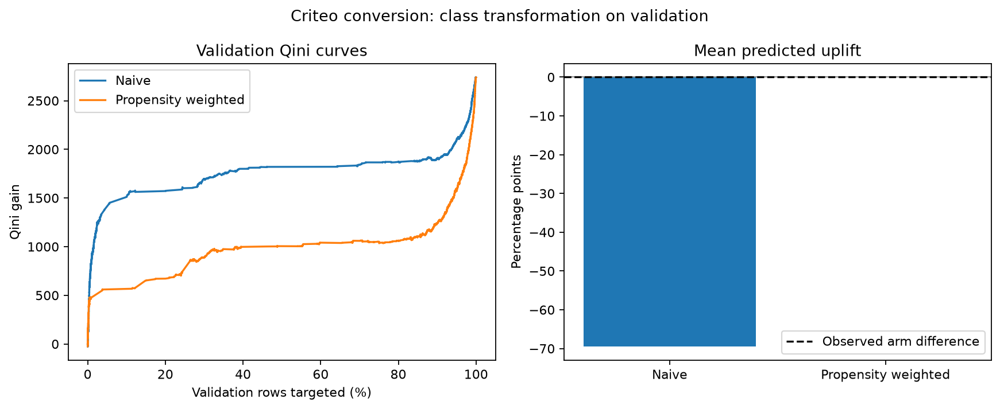

# T56 — Criteo meta-learners and class transformation

## Experiment setup

S-, T-, and X-learners were fitted on the Criteo conversion training split and evaluated on the same validation rows. All runs used fixed LightGBM settings: 100 estimators, learning rate 0.05, 31 leaves, and seed 42. The X-learner used the treated share in training as its constant propensity weight. The test split stayed locked.

## Preliminary validation results

| Learner | Qini coefficient | AUUC | Uplift@10% (pp) | Uplift@20% (pp) | Uplift@30% (pp) | MLflow run ID |
| --- | ---: | ---: | ---: | ---: | ---: | --- |
| S | 0.178017 | 0.005762 | 0.7674 | 0.4798 | 0.3457 | `4042d3813ec34d08b3f5c14a19eb9c92` |
| T | 0.134823 | 0.004355 | 0.7016 | 0.4328 | 0.3081 | `976c5ea630134d08abc526816eba16c1` |
| X | 0.165552 | 0.005345 | 0.7759 | 0.4656 | 0.3273 | `1241bdc26a834f52b90e2a2d9f449708` |

S had the highest Qini and AUUC point estimates among these three runs. X had the highest uplift@10% point estimate. Uplift@k uses the `overall` strategy and is reported above in percentage points. Model selection and comparisons require confidence intervals, which are pending.

All runs finished from clean commit `e7ed5be70d9a31d8ba8bc2807f3bff8159cf2258` and share validation fingerprint `b34c2af09f718c1b826b5ac5a33248a35139532e254cbb6b82fbe43631a8dddf`. Each run saved its fitted model and validation scores keyed by `row_id` in local MLflow.

## Class-transformation demonstration

Mean predicted uplift moved from -69.5342 pp for the naive classifier to +0.0029 pp after propensity weighting. The naive Qini curve was higher across most of the plotted targeting range. This illustrates that a plausible ranking can coexist with implausible uplift magnitudes. The means alone do not establish calibration or ranking superiority.

## Reproduction

From the repository root with the configured Criteo dataset and MLflow environment:

- `python scripts/run_meta_learners.py --model all`
- `python scripts/plot_class_transformation_trap.py`
- `python -m pytest tests/test_meta_learners.py -q` (2 passed locally)
