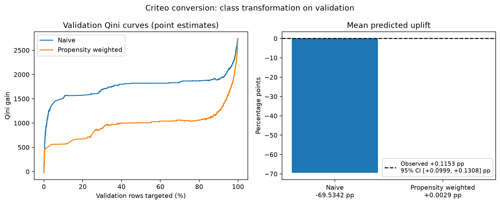

# T56 — Criteo meta-learners and class transformation

## Experiment setup

S-, T-, and X-learners were fitted on the Criteo conversion training split and evaluated on the same validation rows. All runs used fixed LightGBM settings: 100 estimators, learning rate 0.05, 31 leaves, and seed 42. There was no hyperparameter tuning (0 trials). The X-learner used the treated share in training as its constant propensity weight. The test split stayed locked.

## Preliminary validation results

| Learner | Qini coefficient | AUUC | Uplift@10% (pp) | Uplift@20% (pp) | Uplift@30% (pp) | MLflow run ID |
| --- | ---: | ---: | ---: | ---: | ---: | --- |
| S | 0.178017 | 0.005762 | 0.7674 | 0.4798 | 0.3457 | `4042d3813ec34d08b3f5c14a19eb9c92` |
| T | 0.134823 | 0.004355 | 0.7016 | 0.4328 | 0.3081 | `976c5ea630134d08abc526816eba16c1` |
| X | 0.165552 | 0.005345 | 0.7759 | 0.4656 | 0.3273 | `1241bdc26a834f52b90e2a2d9f449708` |

S had the highest Qini and AUUC point estimates among these three runs, contrary to the specification's expectation for the S-learner. The paired intervals below show the uncertainty in the S–X comparison. X had the highest uplift@10% point estimate. Uplift@k uses the `overall` strategy and is reported above in percentage points. Bootstrap intervals and paired comparisons are reported below; the findings remain preliminary.

All runs finished from clean commit `e7ed5be70d9a31d8ba8bc2807f3bff8159cf2258` and share validation fingerprint `b34c2af09f718c1b826b5ac5a33248a35139532e254cbb6b82fbe43631a8dddf`. Each run saved its fitted model and validation scores keyed by `row_id` in local MLflow.

## Bootstrap uncertainty

The saved validation predictions were evaluated with **1,000 paired, within-arm bootstrap resamples**, seed 42, and 95% percentile intervals (2.5th and 97.5th percentiles). Each draw resampled control and treated rows separately with replacement, preserving the observed arm sizes. The same sampled row indices were used for all three learners and all five metrics. Models were not refitted. This covers validation sampling uncertainty conditional on the fitted models, not uncertainty from retraining or hyperparameter selection.

The script checked the evaluation fingerprint and aligned saved scores by `row_id` on the 2,795,918 validation rows before resampling. The results JSON records the same three run IDs and validation fingerprint as the training runs above. It contains aggregate intervals; it does not contain the individual resample metric vectors.

Metrics use scikit-uplift: `qini_auc_score(..., negative_effect=True)`, normalized `uplift_auc_score`, and `uplift_at_k(..., strategy="overall")` at 10%, 20%, and 30%. Qini and AUUC retain the library's scale. Uplift intervals below are converted from probability units to percentage points by multiplying by 100.

### Per-learner intervals

| Learner | Qini | AUUC | Uplift@10% (pp) | Uplift@20% (pp) | Uplift@30% (pp) |
| --- | --- | --- | --- | --- | --- |
| S | [0.145460, 0.212766] | [0.004821, 0.006769] | [0.6107, 0.9220] | [0.4030, 0.5585] | [0.2952, 0.3959] |
| T | [0.103433, 0.168885] | [0.003378, 0.005390] | [0.5604, 0.8354] | [0.3620, 0.5014] | [0.2618, 0.3538] |
| X | [0.133517, 0.197863] | [0.004364, 0.006298] | [0.6337, 0.9273] | [0.3934, 0.5388] | [0.2861, 0.3835] |

### Paired difference intervals

Each interval is computed from the bootstrap distribution of the first learner's metric minus the second learner's metric. It is not calculated by subtracting marginal interval endpoints.

| Difference | Qini | AUUC | Uplift@10% (pp) | Uplift@20% (pp) | Uplift@30% (pp) |
| --- | --- | --- | --- | --- | --- |
| S minus T | [0.015136, 0.071308] | [0.000499, 0.002305] | [-0.0139, 0.1398] | [0.0091, 0.0850] | [0.0126, 0.0614] |
| S minus X | [-0.004030, 0.030761] | [-0.000118, 0.001010] | [-0.0660, 0.0476] | [-0.0138, 0.0400] | [-0.0059, 0.0269] |
| T minus X | [-0.058958, -0.001583] | [-0.001886, -0.000043] | [-0.1513, 0.0070] | [-0.0722, 0.0053] | [-0.0516, -0.0019] |

### Interpretation

- S minus T is positive throughout the 95% intervals for Qini, AUUC, uplift@20%, and uplift@30%. The uplift@10% difference remains uncertain.
- T minus X is negative throughout the intervals for Qini, AUUC, and uplift@30%, favouring X for those metrics. The uplift@10% and uplift@20% differences remain uncertain.
- All five S-minus-X intervals include zero. These results do not resolve a difference between S and X; this is not evidence that they are equivalent.
- All three paired uplift@10% intervals include zero. X's highest point estimate at that contact budget does not establish superiority.

These are exploratory, unadjusted 95% intervals for individual comparisons. They do not establish a final champion or a K1 result. This bootstrap compares S, T, and X only and does not include the tuned response model. The standalone script has not been integrated into the T39 evaluation harness, and this step does not add the intervals or resample vectors to the original MLflow runs.

Source: [bootstrap results JSON](t56-bootstrap-results.json), produced by [`scripts/bootstrap_t56.py`](../scripts/bootstrap_t56.py). The original run IDs and training provenance are unchanged.

## Class-transformation demonstration



Mean predicted uplift moved from -69.5342 pp for the naive classifier to +0.0029 pp
after propensity weighting. The observed treated-minus-control difference on
validation was +0.1153 pp (95% interval [+0.0999, +0.1308] pp), using 1,000
within-arm bootstrap draws with seed 42. The weighted model removed the large
negative level bias in this demonstration. Its mean was still well below the
observed arm difference. Calibration requires a separate assessment.

The Qini curves show descriptive point estimates. The figure and its
[summary JSON](t56-class-transformation-trap.json) record the predicted means
and the observed difference with its interval.

## Reproduction

From the repository root with the configured Criteo dataset and MLflow environment:

- `python scripts/run_meta_learners.py --model all`
- `python scripts/figures/plot_class_transformation_trap.py`
- `python -m pytest tests/test_meta_learners.py -q`

To recompute the bootstrap from the saved scores, configure `MLFLOW_TRACKING_URI`
to point to the tracking store containing the three source runs. From the
repository root, run the following command with the corresponding run IDs:

```text
python scripts/bootstrap_t56.py --resamples 1000 --s-run-id 4042d3813ec34d08b3f5c14a19eb9c92 --t-run-id 976c5ea630134d08abc526816eba16c1 --x-run-id 1241bdc26a834f52b90e2a2d9f449708
```

The script writes directly to `reports/t56-bootstrap-results.json`. Recomputing
the intervals requires access to the source artifacts and takes time. The
completed results are already linked above.
